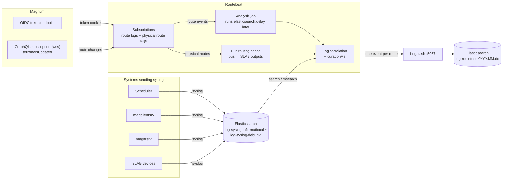
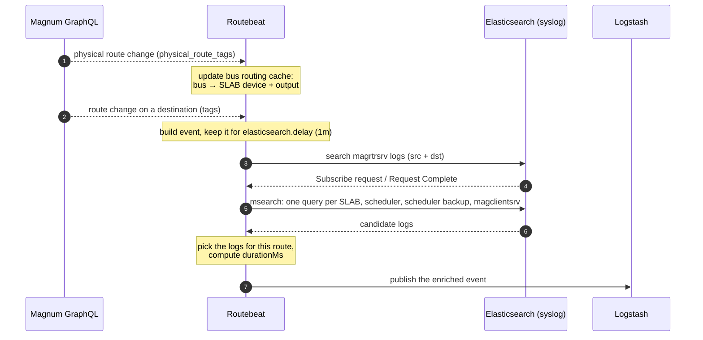
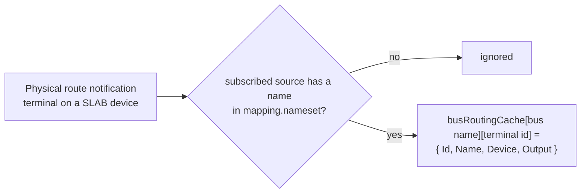
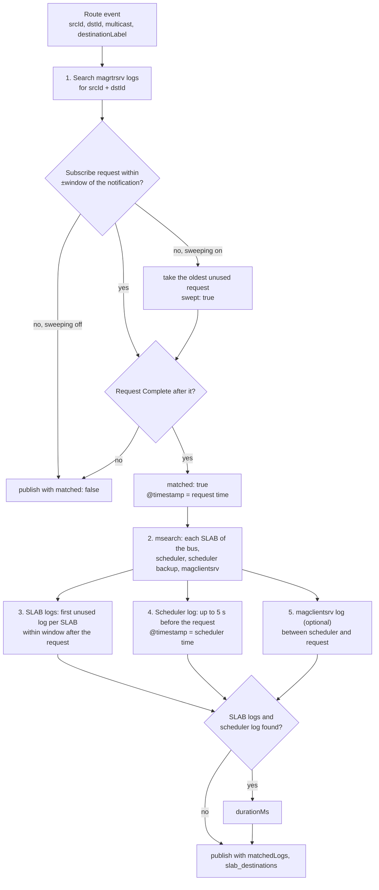

# Routebeat (route timing analysis)

Routebeat is an Elastic Beat that **measures how long Magnum SDVN routes take to complete**. When Magnum reports a route change on a tagged destination, routebeat waits for the syslog from every system involved to reach Elasticsearch. It then searches for the log lines that belong to that one route and links them together. The result is a single event per route change that says what was routed, which logs prove each step happened, and how long the route took from start to finish (`durationMs`).

> This README describes the `sxm_log_analyze` branch. It works differently from `master`: it has no periodic route polling, and every event comes from a subscription notification, after log analysis.

The systems whose logs are linked together, in the order a route passes through them:

| Step | System | Log line routebeat looks for | `matchedLogs.type` |
|---|---|---|---|
| 1 | **Scheduler** (DCS trigger) | `main: SENDING … route …`, or the backup form `dcpipes.jsonrpctcp: SENDING … route …` | `scheduler` |
| 2 | **magclientsrv** (optional) | `INFO:interfaces.server:Received Dispatch Request.` | `magclientsrv` |
| 3 | **Magnum router server** (`magrtrsrv`) | `INFO:jsonrpc:Subscribe request` | `magnum` |
| 4 | **Magnum router server** (`magrtrsrv`) | `INFO:subscription:Subscription Request Complete` | `magnum` |
| 5 | **SLAB** devices, one per physical leg of the route | `AuditSet:DST <output> … <multicast address>` | `slab` |

`durationMs` is the time from the scheduler log (step 1) to the latest SLAB log (step 5): from when the route was asked for to when the last device switched.



## Contents

- [How it works](#how-it-works)
  - [Authentication](#authentication)
  - [Two kinds of subscription](#two-kinds-of-subscription)
  - [Bus routing cache](#bus-routing-cache)
  - [Building the route event](#building-the-route-event)
  - [Delayed analysis](#delayed-analysis)
  - [Log correlation, step by step](#log-correlation-step-by-step)
  - [Duration](#duration)
  - [Preventing a log from being used twice](#preventing-a-log-from-being-used-twice)
  - [Keeping the subscription alive](#keeping-the-subscription-alive)
- [Data it generates](#data-it-generates)
  - [Fields](#fields)
  - [Outcomes](#outcomes)
  - [Example event](#example-event)
  - [Where the data goes](#where-the-data-goes)
- [Requirements on the syslog data](#requirements-on-the-syslog-data)
- [Configuration](#configuration)
- [Running and troubleshooting](#running-and-troubleshooting)
- [Known limitations](#known-limitations)
- [Development](#development)
- [Building on Beats 8.19.25](#building-on-beats-81925)
- [Packaging](#packaging)

## How it works



### Authentication

At startup routebeat gets an access token from the Magnum OIDC token endpoint (`api.auth.token_url`) with the OAuth2 client credentials flow. The token is stored as the `magoidc-token` cookie, which the subscription websocket sends. A background routine fetches a new token every 4 minutes. If the first token can't be fetched, routebeat exits. A failed refresh is logged and retried on the next tick.

> TLS certificate verification is turned off for the Magnum connection, because Magnum servers commonly use self-signed certificates. The Elasticsearch connection has its own TLS settings (see [Configuration](#configuration)).

### Two kinds of subscription

All subscriptions share one websocket, whose URL is `api.url` with the scheme changed to `wss`. Routebeat subscribes to `terminalsUpdated` once per tag:

| Subscription | Tags | Filter | Used for |
|---|---|---|---|
| **Route** | each entry in `tags` | `isTlr`, `isDst`, `isSub: true` | The routes to measure. Each message becomes route events (`eventType: notification`). |
| **Physical route** | each entry in `physical_route_tags` | `isTlr`, `isDst`, `isSub: false` | Physical destinations on the SLAB devices. They fill the [bus routing cache](#bus-routing-cache) and publish nothing themselves. |

Both use the selection set in [beater/models_graphql.go](beater/models_graphql.go), including each terminal's `port` (device name, port ID and stream addresses). The tag is sent wrapped in double quotes so that `listIncludes` matches the whole tag. Route subscriptions are only made when `api.notifications` is `true`; on this branch it must be, or routebeat does nothing.

### Bus routing cache

A route to a bus (a subscription destination) is carried to air by one or more physical destinations on SLAB devices, each subscribed to that bus. To know which SLAB logs belong to a route, routebeat needs to know, for each bus, which SLAB device and output carries it. The physical route subscription provides this:



- **Key:** the subscribed source's name in the `mapping.nameset` nameset, which is the bus name. It matches the route event's `destinationLabel`.
- **Device:** `port.device.name` of the physical terminal, the SLAB name as it appears in syslog's `annotation.general.device_name`.
- **Output:** the last number of the port ID (for example `[111,8,2,32]` → `32`), the output number in the SLAB's `AuditSet:DST <output>` log.

The cache lives in memory only. It starts empty, fills as physical routes change, and is cleared every day at 06:15:55 (the host's local time). Until a bus has had a physical route change since the last restart or clear, its routes are analysed without SLAB logs, so they get no `durationMs`.

### Building the route event

For each destination in a route notification, routebeat:

1. **Checks the tag exactly.** Magnum's tag filter can return destinations whose tags only contain the configured value (`MES` matching `MES-2`), so destinations without an exact match are dropped.
2. **Builds the event** with the destination (`dst*`, `dstNameset.*`), the routed physical source and its port, the subscribed source, and `destinationLabel` / `sourceLabel` from the `mapping.nameset` nameset. `matched` starts as `false`.
3. **Records the multicast address** of the routed physical source's primary (non-backup) stream address, for example `DST IP: 239.32.103.143:5004`. The SLAB logs are matched on this address.

The event's timestamp starts as the time the notification arrived. Correlation replaces it with the time the route started (see [step 3](#log-correlation-step-by-step)).

### Delayed analysis

Syslog takes time to reach Elasticsearch. Each notification's events are therefore held for `elasticsearch.delay` (1 minute recommended) in a one-time job, then analysed and published together. Events reach the output about one `delay` after the route.

### Log correlation, step by step

Every search covers only the **last 30 minutes** of logs, sorted oldest first, with at most 3000 hits per query. With `elasticsearch.strict: false`, index patterns ending in `*` are narrowed to today's and yesterday's daily indices (`…-YYYY.MM.dd`).



**Step 1: Magnum logs.** Routebeat searches `elasticsearch.index` for `process.name: magrtrsrv` messages containing either `INFO:jsonrpc:Subscribe request` or `INFO:subscription:Subscription Request Complete`, plus both the source ID and destination ID. The source ID is the subscribed source's ID, or the routed physical source's when there is no subscribed source.

- **Request:** the first unused request log whose device timestamp is within `elasticsearch.window` of the notification time, before or after. If none is found and `sweeping` is on, the oldest unused request log in the 30 minutes is used instead and the event gets `swept: true`. Sweeping is for Magnum producing route logs with no matching notification, or with a late one.
- **Complete:** the first unused completion log after the request.
- If either is missing, analysis stops and the event is published with `matched: false`.
- If the log just before the chosen completion is a different request log, routebeat logs an `Orphaned request log` error. That request never got its own completion. The event is still published.

When both are found, the event gets `matched: true`, its `@timestamp` becomes the request log's time, and both lines are added to `matchedLogs`.

**Step 2: one multi-search for the other systems.** A single `_msearch` request holds one query per source of logs:

| Query | Index | Must match |
|---|---|---|
| One per SLAB serving the bus (from the bus routing cache) | `log-syslog-informational-*` | `annotation.general.device_name` = SLAB name, and the message contains `AuditSet:DST <output>` and the multicast address |
| Scheduler | `log-syslog-informational-*` | message contains `main: SENDING`, `route`, the source ID and the destination ID |
| Scheduler backup | `log-syslog-debug-*` | message contains `dcpipes.jsonrpctcp: SENDING`, `route`, and both IDs. An ID starting with a letter also matches with a `u'` prefix, as the scheduler writes Python unicode strings. |
| magclientsrv (only with `dev.magclientsrv_logs`) | `log-syslog-informational-*` | `process.name: magclientsrv`, message contains `INFO:interfaces.server:Received Dispatch Request.` and both IDs |

If the event has no multicast address, or none of these queries returns anything, analysis stops here. The event keeps `matched: true` and its two Magnum logs.

**Step 3: SLAB logs.** For each SLAB, the first unused log **after** the Magnum request and no more than `window` after it. A SLAB with no match logs the warning `MatchSlabLogs: no matching log found for key: slab:<name>`. The matched logs are added in time order, each prefixed with the SLAB name.

Two development options adjust SLAB timestamps before matching, for SLABs whose syslog clock isn't in UTC:

- `dev.swap_slab_log_timezone`: read the SLAB's `device.timestamp` as New York wall-clock time (EST/EDT) and convert it to UTC.
- `dev.use_log_ingest_timestamp`: use the log's `@timestamp` (when it was received) instead of `device.timestamp`.

**Step 4: Scheduler log.** The first unused scheduler log from up to **5 seconds before** the Magnum request to 30 ms after it (to allow for clock skew). It goes first in `matchedLogs`, and the event's `@timestamp` becomes the scheduler log's time, the moment the route started.

**Step 5: magclientsrv log** (only with `dev.magclientsrv_logs`). The latest log between the scheduler log and the Magnum request. Without a scheduler log, the latest one up to 5 seconds before the request. It goes right after the scheduler log, or first if there isn't one.

### Duration

When both SLAB logs and a scheduler log were found:

```
durationMs = time of the last entry in matchedLogs (the latest SLAB log)
           − time of the first entry (the scheduler log)
```

The order of `matchedLogs` is always: scheduler, magclientsrv, Magnum request, Magnum complete, then SLAB logs in time order. Entries that weren't found are left out.

```
12:00:00.000  scheduler     main: SENDING … route …            ◀── first entry ─┐
12:00:00.120  magclientsrv  Received Dispatch Request.                         │
12:00:00.300  magnum        INFO:jsonrpc:Subscribe request                     │ durationMs
12:00:00.900  magnum        Subscription Request Complete                      │   = 1400
12:00:01.050  slab          SLAB-A … AuditSet:DST 32 …                         │
12:00:01.400  slab          SLAB-B … AuditSet:DST 7 …          ◀── last entry ──┘
```

If the Magnum completion is logged after the last SLAB log, the duration still ends at the last SLAB log.

### Preventing a log from being used twice

Several routes between the same source and destination can happen within 30 minutes, so the same log can be a candidate for more than one event. Each log that routebeat uses is remembered by its Elasticsearch document ID for **40 minutes** and skipped after that. Expired IDs are removed every hour.

Two exceptions:

- A Magnum **completion log for a salvo** (a message mentioning `sub_dst` more than once) isn't remembered, because one salvo completion answers several requests.
- **magclientsrv logs** aren't remembered.

The memory isn't saved, so after a restart, logs from the previous 30 minutes can be matched again by new notifications.

### Keeping the subscription alive

1. **Idle timeout:** if the websocket receives nothing at all (not even a keep-alive) for 1 minute, the client reconnects by itself.
2. **Run loop:** whenever the client stops, it's started again for as long as subscriptions exist, and every subscription is made again.
3. **Watchdog:** if no notification of either kind has arrived for `api.sub_reconnect_idle` (default 120m), routebeat closes the client on purpose and the run loop reconnects it. This catches a subscription that looks connected but has stopped delivering. Set `sub_reconnect_idle: 0` to turn the watchdog off.

There is no periodic query on this branch, so routes that change while the subscription is down are never reported.

## Data it generates

There's one event per destination in each route notification, published about `elasticsearch.delay` after the notification. A destination that carries two configured tags produces one event for each tag.

### Fields

Routebeat's fields are at the top level of the event. The field definitions are in [_meta/fields.yml](_meta/fields.yml).

**Route (from Magnum)**

| Field | Type | Description |
|---|---|---|
| `dstId` | keyword | Destination terminal ID |
| `dstName` | keyword | Destination terminal name |
| `dstIsSub`, `dstIsDst` | boolean | The destination is a subscription / destination terminal |
| `dstType` | keyword | Magnum terminal type |
| `dstTags` | keyword[] | All tags on the destination |
| `dstTag` | keyword | The configured tag this event was collected for |
| `dstNameset.<nameset>` | keyword | Destination name in each nameset (nameset name lowercased) |
| `eventType` | keyword | Always `notification` on this branch |
| `routeableTerminal.physicalSource.srcId` / `.name` / `.isSrc` | | Routed physical source |
| `routeableTerminal.physicalSource.physTags` | keyword[] | Its tags (only when it has tags) |
| `routeableTerminal.physicalSource.nameset.<nameset>` | keyword | Its name in each nameset |
| `routeableTerminal.physicalSource.port.address` | keyword | Primary stream address, for example `DST IP: 239.32.103.143:5004` |
| `routeableTerminal.physicalSource.port.streamType` / `.port` | keyword | Stream type and port name |
| `routeableTerminal.subscribedSource.srcId` / `.name` / `.isSub` | | Subscribed source |
| `routeableTerminal.subscribedSource.subTags` | keyword[] | Its tags (only when it has tags) |
| `routeableTerminal.subscribedSource.nameset.<nameset>` | keyword | Its name in each nameset |
| `destinationLabel` | keyword | Destination (bus) name in `mapping.nameset`, or `mapping.default` |
| `sourceLabel` | keyword | Subscribed source's name in `mapping.nameset` (else the physical source's), or `mapping.default` |

**Analysis**

| Field | Type | Description |
|---|---|---|
| `@timestamp` | date | When the route started: the scheduler log's time; else the Magnum request log's; else the time the notification arrived |
| `matched` | boolean | Magnum request and completion logs were found for this route |
| `swept` | boolean | The Magnum request log was found by sweeping, outside the window (only when `matched`) |
| `durationMs` | integer | Scheduler log to latest SLAB log, in milliseconds (only when both were found) |
| `matchedLogs[]` | group | The logs linked to this route, in route order |
| `matchedLogs.type` | keyword | `scheduler`, `magclientsrv`, `magnum` or `slab` |
| `matchedLogs.time` | date | The log's device timestamp (after any SLAB time zone adjustment) |
| `matchedLogs.log` | keyword | The syslog message; SLAB messages are prefixed with the SLAB name |
| `slab_destinations[]` | group | Every SLAB physical destination known to serve this bus, from the bus routing cache |
| `slab_destinations.Id` / `.Name` | keyword | Physical terminal ID and name |
| `slab_destinations.Device` | keyword | SLAB device name |
| `slab_destinations.Output` | integer | SLAB output number |

### Outcomes

| Result | `matched` | `matchedLogs` | `durationMs` | Common reasons |
|---|---|---|---|---|
| Fully correlated | `true` | scheduler, (magclientsrv), 2 × magnum, slab… | yes | |
| Partly correlated | `true` | 2 × magnum, plus whatever else was found | no | No physical route seen yet for the bus; no multicast address; scheduler log more than 5 s before the request; SLAB log later than `window` |
| Not correlated | `false` | none | no | Magnum logs not yet in Elasticsearch (raise `delay`); request outside `window`; no completion; no `destinationLabel` |

To find slow routes, filter `matched: true` and sort or chart `durationMs`. `matched: false` and events without `durationMs` show routes that couldn't be measured.

### Example event

A fully correlated route (names and IDs are illustrative; standard Beats fields are left out):

```json
{
  "@timestamp": "2026-11-26T17:00:00.000Z",
  "eventType": "notification",
  "dstId": "b7e0…-dst",
  "dstName": "BUS-0101",
  "dstIsSub": true,
  "dstIsDst": true,
  "dstType": "RouteableTerminal",
  "dstTags": ["MES"],
  "dstTag": "MES",
  "dstNameset": { "broadview": "SXM-BUS-101" },
  "destinationLabel": "SXM-BUS-101",
  "sourceLabel": "STUDIO-3-PGM",
  "routeableTerminal": {
    "physicalSource": {
      "srcId": "4c1a…-phys",
      "name": "ENC-17",
      "isSrc": true,
      "nameset": { "broadview": "ENC-17" },
      "port": { "address": "DST IP: 239.32.103.143:5004", "streamType": "AES67", "port": "OUT 3" }
    },
    "subscribedSource": {
      "srcId": "e93f…-sub",
      "name": "STUDIO-3",
      "isSub": true,
      "nameset": { "broadview": "STUDIO-3-PGM" }
    }
  },
  "matched": true,
  "swept": false,
  "durationMs": 1400,
  "matchedLogs": [
    { "type": "scheduler",    "time": "2026-11-26T17:00:00.000Z", "log": "… main: SENDING … route … e93f… b7e0… …" },
    { "type": "magclientsrv", "time": "2026-11-26T17:00:00.120Z", "log": "INFO:interfaces.server:Received Dispatch Request. …" },
    { "type": "magnum",       "time": "2026-11-26T17:00:00.300Z", "log": "INFO:jsonrpc:Subscribe request …" },
    { "type": "magnum",       "time": "2026-11-26T17:00:00.900Z", "log": "INFO:subscription:Subscription Request Complete …" },
    { "type": "slab",         "time": "2026-11-26T17:00:01.050Z", "log": "SLAB-A … AuditSet:DST 32 … 239.32.103.143 …" },
    { "type": "slab",         "time": "2026-11-26T17:00:01.400Z", "log": "SLAB-B … AuditSet:DST 7 … 239.32.103.143 …" }
  ],
  "slab_destinations": [
    { "Id": "…", "Name": "SLAB-A OUT 32", "Device": "SLAB-A", "Output": 32 },
    { "Id": "…", "Name": "SLAB-B OUT 7",  "Device": "SLAB-B", "Output": 7 }
  ]
}
```

### Where the data goes

The generated `routebeat.yml` sends to Logstash, using the pipeline in [logstash/](logstash/):

- [logstash/logstash.conf](logstash/logstash.conf): beats input on port 5057, written to the daily index `log-routetest-YYYY.MM.dd`, and forwarded to the `rabbitmq` pipeline.
- [logstash/elasticsearch-template-routetest.json](logstash/elasticsearch-template-routetest.json): the index template for `log-routetest-*`. When you add a field to `_meta/fields.yml`, add its mapping here too.

When sending directly to Elasticsearch (`output.elasticsearch`), routebeat writes to the `routebeat-<version>` data stream (`routebeat-8.19.25` for this release). Load the index template (`routebeat setup --index-management`) before the first run.

The `elasticsearch:` section under `routebeat:` is a **separate connection**, used only to read syslog. It can point at the same cluster as the output, or at a different one.

## Requirements on the syslog data

Routebeat expects the syslog documents to have these fields:

| Field | Used for |
|---|---|
| `@timestamp` | The 30-minute range filter, sorting, and `dev.use_log_ingest_timestamp` |
| `device.timestamp` | Every time comparison and `matchedLogs.time` |
| `log.syslog.message` | Matching the log text, source and destination IDs, output and multicast address |
| `process.name` | Selecting `magrtrsrv` and `magclientsrv` logs |
| `annotation.general.device_name` | Selecting each SLAB's logs |

Scheduler, SLAB and magclientsrv logs must be in daily indices named `log-syslog-informational-YYYY.MM.dd`, and backup scheduler logs in `log-syslog-debug-YYYY.MM.dd`. These index names are fixed in [beater/analytics/multi_search.go](beater/analytics/multi_search.go). Only the Magnum log index comes from `elasticsearch.index`.

## Configuration

Settings are under `routebeat:` in [routebeat.yml](routebeat.yml). [routebeat.reference.yml](routebeat.reference.yml) lists every option. Both files are generated from [_meta/config/](_meta/config/), so make permanent changes there.

```yaml
routebeat:
  tags: ["MES", "IPAN"]          # routes to measure (at least one)
  physical_route_tags: ["SLAB"]  # SLAB physical destinations (at least one)

  mapping:                       # required
    nameset: "Broadview"         # nameset holding the bus names (exact case)
    default: ""

  elasticsearch:
    address: "http://127.0.0.1:9200"     # default: the local node
    index: "log-syslog-informational-*"   # Magnum (magrtrsrv) logs (default)
    #api_key: "id:api_key"                # or username / password
    #ssl:
    #  ca_cert: "/etc/routebeat/ca.crt"
    strict: false
    delay: 1m                    # default
    window: 45s                  # default
    sweeping: false
    #dev:
    #  swap_slab_log_timezone: false
    #  use_log_ingest_timestamp: false
    #  magclientsrv_logs: false

  api:
    url: "https://<magnum>/graphql/v1.1"
    notifications: true          # must be true on this branch
    sub_reconnect_idle: 120m
    auth:
      client_id: "<client id>"
      client_secret: "<client secret>"
      token_url: "https://<magnum>/auth/realms/magnum/protocol/openid-connect/token"
```

| Setting | Default | Description |
|---|---|---|
| `tags` | none | Magnum tags of the destinations whose routes are measured. Routebeat won't start without one. |
| `physical_route_tags` | none | Magnum tags of the SLAB physical destinations. Routebeat won't start without one. |
| `mapping.nameset` | none | Nameset whose names are the bus names, used for `destinationLabel`, `sourceLabel` and the bus routing cache key. Routebeat won't start without it. |
| `mapping.default` | `""` | Label used when a name is missing. |
| `elasticsearch.address` | `http://127.0.0.1:9200` | Elasticsearch URL for reading syslog. The default suits the usual setup, with routebeat on an Elasticsearch node. Can't be blank. |
| `elasticsearch.index` | `log-syslog-informational-*` | Index pattern holding the `magrtrsrv` logs. Can't be blank. |
| `elasticsearch.api_key` | | `id:key` API key. Takes precedence over username and password. |
| `elasticsearch.username`, `.password` | | Basic authentication. Both must be set, or neither. |
| `elasticsearch.ssl.ca_cert` | | PEM CA certificate, trusted in addition to the system CAs. |
| `elasticsearch.ssl.insecure_skip_verify` | `false` | Skip certificate verification. |
| `elasticsearch.strict` | `false` | `false` narrows `…-*` patterns to today's and yesterday's indices; `true` uses the patterns as written. |
| `elasticsearch.delay` | `1m` | Wait before analysing a notification, so its syslog has arrived. Can't be negative. |
| `elasticsearch.window` | `45s` | How far the Magnum request log may be from the notification, and the SLAB logs from the request. Must be greater than 0. |
| `elasticsearch.sweeping` | `false` | Use the oldest unused request log when none is within `window`. |
| `elasticsearch.dev.swap_slab_log_timezone` | `false` | Treat SLAB `device.timestamp` as New York local time. |
| `elasticsearch.dev.use_log_ingest_timestamp` | `false` | Use SLAB logs' `@timestamp` instead of `device.timestamp`. |
| `elasticsearch.dev.magclientsrv_logs` | `false` | Also search for and link magclientsrv logs. |
| `api.url` | | Magnum GraphQL URL. The subscription uses the same URL with `wss`. |
| `api.notifications` | `true` | Open the subscriptions. Must stay `true`. |
| `api.sub_reconnect_idle` | `120m` | Reconnect the subscription after this long without a notification. `0` turns the watchdog off. |
| `api.auth.*` | | Magnum OIDC client credentials and token URL. |
| `period`, `api.limit` | | Present in the templates, but not used on this branch. |

> `mage update`, `mage config` and `mage package` regenerate `routebeat.yml` from the templates. Keep site-specific settings in a copy outside the repository, or in `_meta/config/`.

## Running and troubleshooting

[logstash/systemd/routebeat.service](logstash/systemd/routebeat.service) runs routebeat from `/opt/packages/routebeat` as the `insite` user and restarts it if it stops:

```bash
cp logstash/systemd/routebeat.service /lib/systemd/system/
systemctl daemon-reload
systemctl enable --now routebeat
```

To run in the foreground with routebeat's debug messages:

```bash
./routebeat -c routebeat.yml -e -d "ProcessResults,ScanEvents,AnalyzeLogCollection"
```

| Debug selector | Shows |
|---|---|
| `ProcessResults` | Each route notification, how many events were scheduled, and their bus names |
| `ScanEvents` | Each physical route added to the bus routing cache (SLAB, output, bus) |
| `AnalyzeLogCollection` | Why an event wasn't matched: no logs, no request log, or no completion log |

Useful log lines at the default level:

| Message | Meaning |
|---|---|
| `Subscription made for Tag` | A subscription was opened |
| `subscription client connected` / `disconnected` | Websocket state |
| `Subscription went stale (Idle Timeout)` | Idle timeout reconnect |
| `subscription reconnect watchdog enabled` / `disabled` | Watchdog setting at startup |
| `closing subscription client to test reconnect logic` | Watchdog reconnect after `sub_reconnect_idle` |
| `MatchSlabLogs: no matching log found for key: slab:<name>` | A SLAB of the bus had no log within `window` after the request |
| `Orphaned request log found` | A Magnum request log has no completion of its own |
| `SearchMultiLogs: msearch error` | One of the multi-search queries failed (for example, a missing index) |
| `Daily Bus Routing cache clear` | The bus routing cache was emptied |

If most events come out `matched: false`, check that the `magrtrsrv` logs are in `elasticsearch.index` and arrive within `delay`, and that the Magnum server's clock agrees with the time the notifications arrive (within `window`). If events are `matched` but have no `durationMs`, check `slab_destinations`: if it's missing, no physical route has been seen for the bus since the last restart or daily clear.

## Known limitations

**Coverage**

- **No polling.** Only route changes are reported, and only while the subscription is up. Changes made while it's down are lost. With `api.notifications: false`, routebeat opens no subscriptions and reports nothing.
- **`period` and `api.limit` do nothing.** They're left over from `master`'s polling and are still in the config templates.
- **The bus routing cache isn't saved.** After a restart, or after the daily clear at 06:15:55 (the host's local time), buses get no SLAB logs or `durationMs` until their physical route changes again.

**Matching**

- **Primary and backup scheduler logs.** If both scheduler queries find a log, both are marked as used, and which one is kept depends on map iteration order.
- **magclientsrv logs aren't marked as used**, so one magclientsrv log can be linked to two routes close together.
- **Sweeping can pick the wrong request.** It takes the oldest unused request log in the last 30 minutes, which can belong to an earlier route. Such events are flagged `swept: true`.
- **One window for two jobs.** `elasticsearch.window` limits both how far the Magnum request may be from the notification and how long after the request a SLAB may log. They can't be tuned separately.
- **The used-log memory isn't saved.** After a restart, logs from the previous 30 minutes can be linked again to new notifications.

**Searching**

- **Search depth.** Searches cover only the last 30 minutes, with at most 3000 hits per query. A `delay` near 30 minutes, or a very busy source and destination pair, can miss logs.
- **Fixed index names.** The scheduler, SLAB and magclientsrv indices (`log-syslog-informational-*`, `log-syslog-debug-*`) are fixed in code; only the Magnum index is configurable.

**Diagnosis**

- **The reason a route wasn't measured isn't in the event.** `matched: false` or a missing `durationMs` doesn't say which step failed. The reason is only in the debug log (`-d "AnalyzeLogCollection"`) or the `MatchSlabLogs` warnings.

## Development

| Task | Command |
|---|---|
| Build the binary (local testing only) | `go build -o routebeat .` or `mage build` |
| Run the tests | `go test ./...` |
| Regenerate fields, docs and config files | `PYTHON_EXE=python3.12 mage update` |
| Clean build artifacts | `mage clean` |

Code layout:

| Path | Contents |
|---|---|
| [beater/routebeat.go](beater/routebeat.go) | Subscriptions and watchdog, bus routing cache updates, event builder, delayed analysis job, `AnalyzeLogCollection` |
| [beater/analyze_logs.go](beater/analyze_logs.go) | Magnum log matching, multi-search setup, SLAB / scheduler / magclientsrv matching |
| [beater/analytics/](beater/analytics/) | Elasticsearch client (auth, TLS), the Magnum search and the multi-search queries, index name helpers |
| [beater/cache/](beater/cache/) | Generic thread-safe cache with expiry (used-log memory and bus routing cache) |
| [beater/models_graphql.go](beater/models_graphql.go) | GraphQL subscription model, with the full subscription text |
| [beater/httpclient/](beater/httpclient/) | Magnum OIDC authentication and token refresh |
| [beater/utils.go](beater/utils.go), [beater/types.go](beater/types.go) | Port output and multicast parsing, nameset helpers, error handling |
| [config/config.go](config/config.go) | Configuration structure and defaults |
| [_meta/](_meta/) | Field definitions and config templates |
| [logstash/](logstash/) | Logstash pipeline, index template and systemd unit |

For packaging, use `mage package` as described below. Never ship a binary from `go build` or `mage build`.

## Building on Beats 8.19.25

Routebeat is built on Elastic Beats **8.19.25** with Go **1.26**. It uses a fork of Beats, [thetherington/beats8](https://github.com/thetherington/beats8) (branch `tropobeat-8.19.25`, tag `v7.9.19`), which carries two changes to libbeat:

- `libbeat/publisher/processing/processors.go` fixes the debug "Publish event" log line.
- `libbeat/mapping/field.go` accepts the `geo_shape` field type (not used by routebeat; harmless).

`go.mod` points at the fork with `replace github.com/elastic/beats/v7 => github.com/thetherington/beats8/v7 v7.9.19`. The module path stays `github.com/elastic/beats/v7`. The fork's tags are used by other beats, so add a new tag for each change and never move an existing one.

Building against the published tag in module mode is enough. A Go workspace is optional and only needed when changing the fork at the same time:

```
routebeat_workspace/
├── go.work        # uses ./beats and ./routebeat
├── beats/         # thetherington/beats8 checkout, branch tropobeat-8.19.25
└── routebeat/     # this repository
```

> **Packaging ignores the workspace.** Packaging builds inside a container that mounts only `routebeat/`, so it can't see `go.work` or `../beats` and uses the fork version in `go.mod`. Run `go mod tidy` with `GOWORK=off` so that `go.mod` matches what packaging builds, and push and tag fork changes before packaging.

After changing `_meta/fields.yml` or the config templates in `_meta/config/`, regenerate `fields.yml`, `include/fields.go`, the docs and the `routebeat*.yml` files:

```bash
PYTHON_EXE=python3.12 mage update
```

> `mage update` **overwrites** `routebeat.yml`, `routebeat.reference.yml` and `routebeat.docker.yml` from the templates. `mage package` and `mage config` do the same. Copy any local edits first, or make them in `_meta/config/`.

> **Python 3.12.** `mage update` sets up Beats' Python test environment, whose pinned packages don't install on Python 3.13 or later. If the system Python is newer, install 3.12 (for example `uv python install 3.12`) and set `PYTHON_EXE=python3.12`. If the environment was already created with the wrong Python, delete `build/python-env` first.

> **Don't use `mage fmt` or `mage check` on the Python files.** Beats pins an old autopep8 that, under Python 3.12, corrupts f-strings. If either command was run, revert its changes to `*.py` files.

## Packaging

```bash
BEAT_GO_VERSION=1.26.11 PYTHON_EXE=python3.12 PLATFORMS=linux/amd64 mage package
git checkout -- routebeat.yml    # package runs update, which resets it
```

This builds the tar.gz, deb, rpm and two Docker images (Ubuntu and Wolfi) in `build/distributions/`. Omit `PLATFORMS` to build every platform. Packaging needs Docker. The binary is compiled in Elastic's `golang-crossbuild` image, on Debian 11, so it runs on older Linux (it needs nothing newer than glibc 2.3.3). Don't put a binary from `mage build` into a package: a host build needs the host's newer glibc.

**Go version.** Without `BEAT_GO_VERSION`, packaging uses the Go version Beats asks for (1.26.10) and Elastic's image for it. Go 1.26.11 fixes GO-2026-6859 (`net/http`). Until Elastic publishes a 1.26.11 image, packages are built with a local stand-in: Elastic's 1.26.10 image with Go replaced by the official release, tagged with the name the packaging step looks for:

```dockerfile
# docker build -t docker.elastic.co/beats-dev/golang-crossbuild:1.26.11-main-debian11 .
# Download go1.26.11.linux-amd64.tar.gz from go.dev/dl into the build folder first, and check it:
# sha256 9849f4e04ee35303714e34fbc3ac8ab44ea3e448a95aa182f91e3b9b79c710ec
FROM docker.elastic.co/beats-dev/golang-crossbuild:1.26.10-main-debian11
COPY go1.26.11.linux-amd64.tar.gz /tmp/go.tgz
RUN rm -rf /usr/local/go && tar -C /usr/local -xzf /tmp/go.tgz && rm /tmp/go.tgz
LABEL org.opencontainers.image.description="LOCAL BUILD: golang-crossbuild 1.26.10-main-debian11 with Go upgraded to official go1.26.11"
```

When Elastic publishes their own image, remove the local one (`docker rmi docker.elastic.co/beats-dev/golang-crossbuild:1.26.11-main-debian11`) and package again.

**Check every package before release.** Confirm the Go version, the fork version and the libraries that were actually compiled in:

```bash
tar -xzf build/distributions/routebeat-oss-*-linux-x86_64.tar.gz -C /tmp
go version -m /tmp/routebeat-*-linux-x86_64/routebeat | grep -E 'go1\.|beats8|x/crypto|x/net'
go run golang.org/x/vuln/cmd/govulncheck@latest -mode=binary /tmp/routebeat-*-linux-x86_64/routebeat
```

**Deployment.** The data stream name changes to `routebeat-8.19.25`. Load the new index template before starting the beat. Dashboards that read `routebeat-*` need no change.
