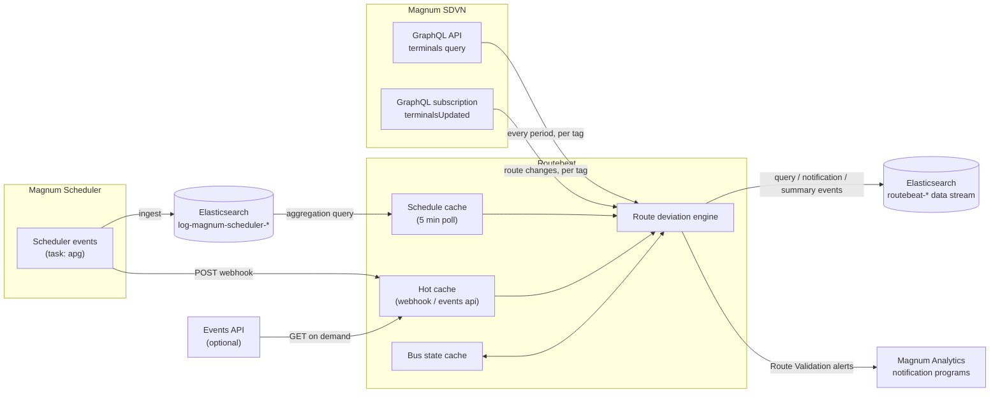
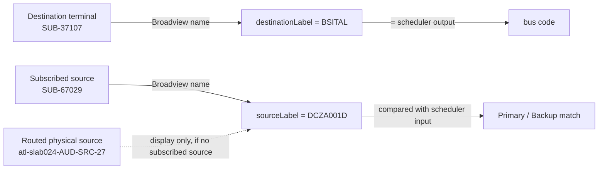
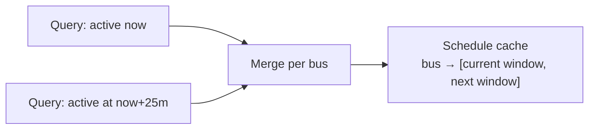
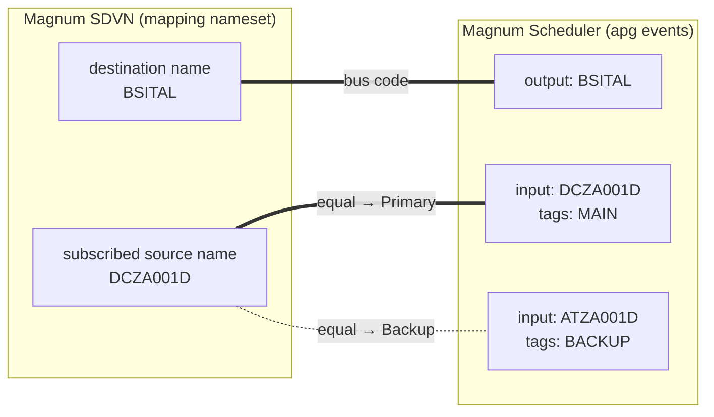
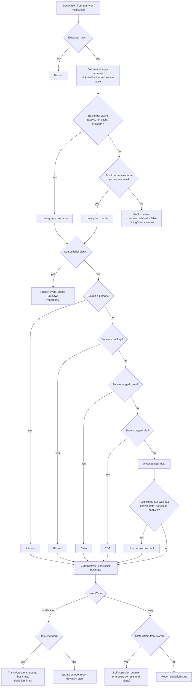
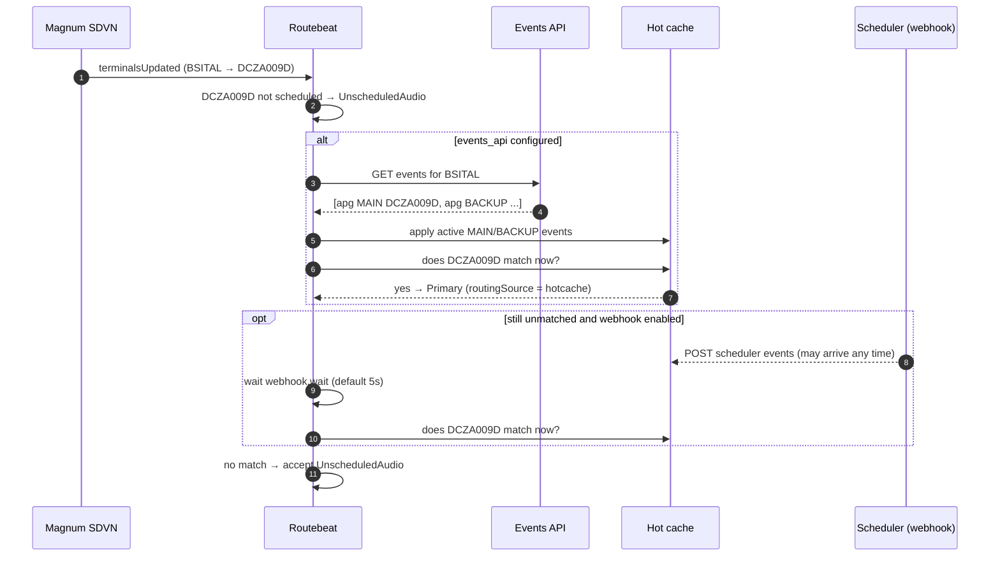
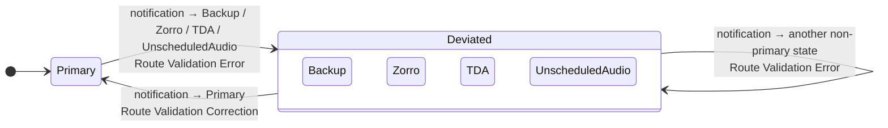
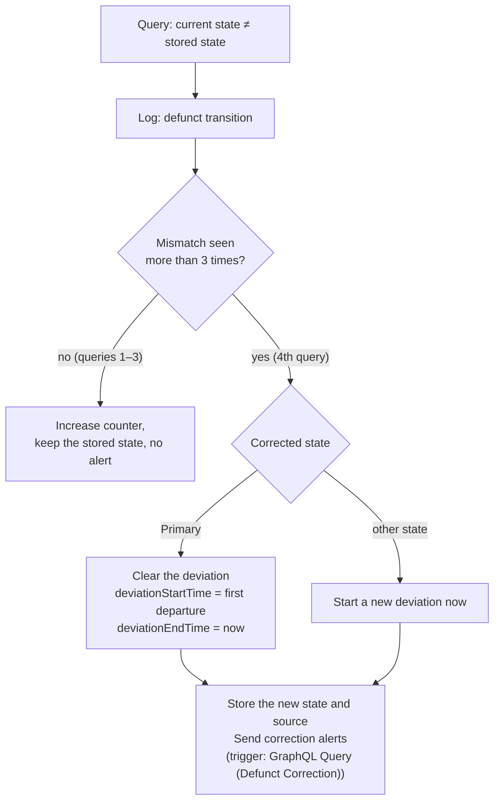

# Routebeat: Route Deviation

Routebeat is an Elastic Beat that watches audio routes in **Magnum SDVN** and checks them against the **Magnum Scheduler**. For every bus (destination) it decides whether the route on air is the scheduled **Primary** source, the scheduled **Backup** source, a known fallback (**Zorro** or **TDA**), or something nobody scheduled (**Unscheduled Audio**).

Every check is published to Elasticsearch as an event. Every change of state is also sent as an alert to the **Magnum Analytics** notification programs, so downstream systems can open and close tickets for route deviations.



---

## Contents

- [Concepts](#concepts)
- [Magnum SDVN: routes](#magnum-sdvn-routes)
  - [Periodic route queries](#periodic-route-queries)
  - [Subscription notifications](#subscription-notifications)
  - [Tag filtering](#tag-filtering)
  - [Nameset filtering and labels](#nameset-filtering-and-labels)
- [Magnum Scheduler: the schedule](#magnum-scheduler-the-schedule)
  - [Scheduler event format](#scheduler-event-format)
  - [Schedule cache (Elasticsearch poll)](#schedule-cache-elasticsearch-poll)
  - [Hot cache (webhook and events API)](#hot-cache-webhook-and-events-api)
  - [How schedule labels match nameset labels](#how-schedule-labels-match-nameset-labels)
- [Finding route deviation](#finding-route-deviation)
  - [Routing states](#routing-states)
  - [Decision logic](#decision-logic)
  - [Unscheduled recheck](#unscheduled-recheck)
  - [Transitions and deviation times](#transitions-and-deviation-times)
  - [Self-correction when out of sync](#self-correction-when-out-of-sync)
- [Alerts](#alerts)
  - [Alert types](#alert-types)
  - [Notification schema](#notification-schema)
  - [Delivery](#delivery)
- [Event payloads](#event-payloads)
  - [Query and notification events](#query-and-notification-events)
  - [Summary events](#summary-events)
- [Configuration](#configuration)
- [Webhook and events API reference](#webhook-and-events-api-reference)
- [Persistence](#persistence)
- [Building, running and testing](#building-running-and-testing)

---

## Concepts

| Term | Meaning |
|---|---|
| **Bus / destination** | A Magnum SDVN destination terminal (`isDst`, `isSub`, `isTlr`) that carries a scheduled audio program. It's identified to the scheduler by its **bus code**, for example `BSITAL`. |
| **Source** | What the destination is subscribed to right now. It's identified by its label in the mapping nameset, for example `DCZA001D`. |
| **Tag** | A Magnum tag (for example `IPAN`) that groups destinations. Routebeat queries and subscribes once per configured tag. |
| **Mapping nameset** | The Magnum nameset (for example `Broadview`) whose names are the labels shared with the scheduler. |
| **Schedule routing** | For a bus and a time window, the scheduled **primary** (`MAIN`) and **backup** (`BACKUP`) source labels. |
| **Deviation** | Any time a bus isn't on its scheduled primary source. |

---

## Magnum SDVN: routes

Routebeat signs in to Magnum with OIDC client credentials (`api.auth`) and talks to the Magnum GraphQL API at `api.url`. It gets routes in two ways, and both feed the same deviation engine:

| | Periodic query | Subscription notification |
|---|---|---|
| GraphQL operation | `query terminals` | `subscription terminalsUpdated` |
| Trigger | every `period`, for each tag | each time Magnum pushes a route change for a tag |
| Event `eventType` | `query` | `notification` |
| Changes the bus state | only to [self-correct](#self-correction-when-out-of-sync) | yes, this is the main way state changes |
| Sends alerts | only on self-correction | yes, on every state change |
| Counters | replaces the tag counters | adjusts the tag counters incrementally |

### Periodic route queries

Every `period` (default 10s), routebeat runs one query per tag. Up to `api.limit` destinations are returned (default 2000). With `api.serialize_queries: true`, the queries for different tags run one at a time to reduce load on the API.

```graphql
query ($limit: Int!, $tag: String!) {
  terminals(input: { filters: [
    { id: "isTlr", booleanValue: true }
    { id: "isDst", booleanValue: true }
    { id: "isSub", booleanValue: true }
    { id: "tags",  listIncludes: [$tag] }
  ]}) {
    totalCount
    edges(limit: $limit) {
      id name tags isSub isDst type
      namesetNames { id name nameset { id name } }
      ... on RouteableTerminal {
        routedPhysicalSource { id name isSrc namesetNames { id name nameset { id name } } }
        subscribedSource     { id name isSub tags namesetNames { id name nameset { id name } } }
      }
    }
  }
}
```

The query is the baseline: every destination is reported on every cycle, so dashboards always show the current state, even if a notification was missed.

### Subscription notifications

When `api.notifications: true`, routebeat opens a GraphQL subscription over a websocket for each tag. The websocket URL is `api.url` with the scheme changed to `wss`. The selection set is the same as the query:

```graphql
subscription ($tag: String!) {
  terminalsUpdated(input: { filters: [ ...same filters as the query... ] }) {
    id name tags isSub isDst type
    namesetNames { ... }
    ... on RouteableTerminal { routedPhysicalSource { ... } subscribedSource { ... } }
  }
}
```

Each message holds the destinations whose routes just changed. These **notification** events drive state transitions and alerts, so routebeat reacts as soon as a route is taken rather than on the next poll.

The subscription is kept alive in these ways:
- When the websocket goes idle (1 minute with no keep-alive), the client reconnects.
- When the client stops, it's restarted for as long as there are active subscriptions.
- If no notification has arrived for `api.sub_reconnect_idle` (default 120m), routebeat closes the client on purpose and resubscribes. This guards against a subscription that looks connected but has silently stopped delivering.

### Tag filtering

The GraphQL `tags` filter (`listIncludes`) can also match tags that only *contain* the configured value. For example, a filter for `MES` can return a destination tagged `MES-2`. Routebeat therefore checks every destination again for an **exact** match of the tag. Destinations that don't match are dropped silently and counted as *discarded* in the debug logs.

### Nameset filtering and labels

Each Magnum terminal has one name per nameset (`namesetNames`). Routebeat uses namesets in two ways.

**1. All namesets are copied onto the event** with lowercase nameset names, so any of them can be searched:

| Terminal | Event field |
|---|---|
| Destination | `dstNameset.<nameset>` |
| Routed physical source | `routeableTerminal.physicalSource.nameset.<nameset>` |
| Subscribed source | `routeableTerminal.subscribedSource.nameset.<nameset>` |

**2. The mapping nameset picks the labels** that are compared with the scheduler. When `mapping.nameset` is set (for example `Broadview`):

| Label | Taken from | When the nameset is missing |
|---|---|---|
| `destinationLabel` | the destination's name in the mapping nameset | `mapping.default` |
| `sourceLabel` | the **subscribed source**'s name in the mapping nameset. If there's no subscribed source, the routed physical source's name is used for display. | `mapping.default` |



Notes:
- The nameset name must match exactly, including case (`Broadview`). The event field names are lowercased (`dstNameset.broadview`).
- **Only the subscribed source's label is used to decide the routing state.** A destination with no subscribed source has no source label to compare, so it's reported as `unknown` (see [Routing states](#routing-states)).
- Without a `mapping` section, no labels are produced and no destination can be matched to the schedule. Events are still published with `schedule.matched: false`.

---

## Magnum Scheduler: the schedule

The Magnum Scheduler decides which source each bus should be on, and when. Routebeat reads its **APG events** (`task: "apg"`) from two places:

1. **Elasticsearch.** The scheduler events are ingested into `log-magnum-scheduler-*`, and routebeat polls them every `elasticsearch.period` to build the **schedule cache**.
2. **Directly.** Scheduler events are pushed to the routebeat **webhook**, or fetched on demand from the **events API**, to build the **hot cache**. This covers fast schedule changes that the 5 minute poll would miss.

### Scheduler event format

The scheduler sends one APG event per bus, per window, per role. The same bus and window has one event tagged `MAIN` (the primary source) and one tagged `BACKUP` (the backup source).

```json
{
  "task": "apg",
  "output": "PMQE04",
  "input": "REM546",
  "tags": ["MAIN"],
  "start_date": "2026/08/25 16:00:00",
  "end_date": "2026/08/25 17:00:00",
  "start": "1787673600000000000",
  "end": "1787677200000000000",
  "state": 1,
  "event_id": "d61b2c83-31c4-44a7-9363-4b39dab22f30",
  "schedule_id": "12856158&1787673600000000000",
  "event_params": {
    "apg_id": "37063667",
    "apg_rule": "Pad1Pad2",
    "bus_name": "{event.output}",
    "pri_src": "{event.input}",
    "sec_src": "REM126",
    "historic": true
  },
  "output_type": "magnum", "output_id": "dce1834d-...", "output_pooled": false, "output_blocking": true,
  "input_type": "magnum",  "input_id": "85a25e52-...",  "input_pooled": false,  "input_blocking": false,
  "entry": "manual", "comment": "", "error": "", "history": [], "recur": {},
  "start_offset": "0", "end_offset": "0"
}
```

Fields routebeat uses:

| Field | Meaning | Used as |
|---|---|---|
| `task` | event type | only `apg` is used; everything else is ignored |
| `output` | the bus code (destination) | the schedule key; matched with `destinationLabel` |
| `input` | the scheduled source label | the **primary** when tagged `MAIN`, the **backup** when tagged `BACKUP` |
| `tags` | role of the event | must include `MAIN` or `BACKUP`. Other tags (`EXTERNAL`, `PxP`, ...) can appear alongside them and are ignored |
| `start_date` / `end_date` | the scheduled window, **UTC**, format `YYYY/MM/DD HH:MM:SS` | the event is only used while it's active |
| `start` / `end` | the same window as epoch nanoseconds | not used. They're strings in the webhook and events API payloads and numbers once ingested into Elasticsearch |

### Schedule cache (Elasticsearch poll)

Every `elasticsearch.period` (default 5m), routebeat runs two aggregation queries against `elasticsearch.index`, one for **now** and one for **now + 25 minutes**:

- **Filter:** `@timestamp` in the last 4 hours, `event.module: event`, `scheduler.event.task: apg`, and `scheduler.event.start_date ≤ T ≤ scheduler.event.end_date`.
- **Aggregate:** by `scheduler.event.output` (the bus code, up to 3000 buses). Then:
  - by `scheduler.event.tags`: the latest `scheduler.event.input` for `MAIN` becomes the primary, and the latest for `BACKUP` becomes the backup;
  - the latest `scheduler.event.start_date` and `scheduler.event.end_date`.

  "Latest" always means the document with the newest `@timestamp`.



Each bus stores its current window and its upcoming window. When routebeat looks up a bus, it uses the window that's **active right now**, so the cache moves to the next program at the top of the hour without waiting for the next poll. With `elasticsearch.dev.validate_end_date: false`, the first stored window is used whatever its dates (for development only).

### Hot cache (webhook and events API)

The scheduler can change a route seconds before or after air (advances, fast-forwards, manual changes). The 5 minute poll can be up to 5 minutes behind. The **hot cache** holds overrides for these fast changes:

| Feed | How it arrives |
|---|---|
| **Webhook** (`webhook.enabled`) | the scheduler POSTs events to `http://<routebeat>:<webhook.port>/api/v1/scheduler/events` |
| **Events API** (`events_api.url`) | routebeat GETs the latest events for one bus, **only when that bus has just gone unscheduled** (see [Unscheduled recheck](#unscheduled-recheck)) |

Both feeds take the same payload, either a single scheduler event or a list of them, and both are processed the same way:

1. Anything that isn't an `apg` event is dropped cheaply, before it's fully decoded. That includes other tasks such as `route`, `silence` and `xmuds`, and schedule-shaped documents.
2. Events not tagged `MAIN` or `BACKUP`, and events **not active right now**, are dropped. **Only active events ever enter the hot cache.**
3. The remaining events are grouped by `output`. A `MAIN` event sets the primary, a `BACKUP` event sets the backup.
4. When the new event's window overlaps an existing hot entry for the same bus, the two are merged: a `BACKUP` event that arrives after the `MAIN` one fills in the backup without wiping the primary. Otherwise the new event replaces the entry.

Rules for using the hot cache:
- An active hot entry **takes priority** over the schedule cache for that bus.
- Every read checks that the entry is still active, and expired entries are removed every 10 minutes.
- If the webhook and the events API are **both off**, the hot cache isn't used at all.

The event's `schedule.routingSource` says where the schedule came from:

| Value | Meaning |
|---|---|
| `cache` | the schedule cache (Elasticsearch poll) |
| `hotcache` | the hot cache (webhook or events API) |
| `none` | the bus wasn't found in either cache |

### How schedule labels match nameset labels

The mapping nameset and the scheduler use the same names. That shared naming is what joins the two systems:



| SDVN (mapping nameset) | Scheduler | Result |
|---|---|---|
| destination name | `output` | finds the bus's schedule |
| subscribed source name = `input` of the `MAIN` event | primary | **Primary** |
| subscribed source name = `input` of the `BACKUP` event | backup | **Backup** |

Labels are compared exactly. A blank source label never matches, even when the schedule has a blank primary or backup.

---

## Finding route deviation

### Routing states

| State | `schedule.status` | Meaning |
|---|---|---|
| Primary | `Primary` | on the scheduled primary (`MAIN`) source |
| Backup | `Backup` | on the scheduled backup (`BACKUP`) source |
| Zorro | `Zorro` | on a source carrying the configured `zorro` tag (a known fallback) |
| TDA | `TDA` | on a source carrying the configured `tda` tag (a known fallback) |
| Unscheduled | `UnscheduledAudio` | on a source that's neither scheduled nor a known fallback |
| Unknown | `unknown` | the destination has no subscribed source label, so no state can be decided. These events are **report-only**: they don't change the stored bus state, send alerts or affect counters |

A label match always wins over a tag match. A source that is the scheduled primary and also carries the Zorro tag is **Primary**.

### Decision logic



### Unscheduled recheck

`UnscheduledAudio` is often a false alarm: the scheduler has just moved the bus to a new source, and the routebeat schedule hasn't caught up yet. When a **notification** moves a bus from a known state into `UnscheduledAudio`, and the hot cache is enabled, routebeat checks again before reporting it:



- If the events API is configured, it's tried first. A match returns straight away, without waiting.
- If the API is down, returns an error or doesn't match, the webhook wait is used as a fallback (when the webhook is on).
- With both the webhook and the events API off, `UnscheduledAudio` is accepted immediately.
- The recheck never runs for queries, for buses seen for the first time, or for buses already unscheduled.
- A recheck delays the destinations after it in the same batch by up to `webhook.wait` plus the events API timeout.

### Transitions and deviation times

Routebeat stores a **bus state** for every bus: the last state, the source label, and the deviation times. A notification that changes the state is a **transition**:



On every transition routebeat:
1. Sends the [alerts](#alerts): one closing the previous state and one opening the new state.
2. Moves the tag counters from the previous state to the new one.
3. Sets `schedule.deviationStartTime` to the time of the change.
4. On a return to **Primary**, sets `schedule.deviationStartTime` to when the bus *first* left Primary and `schedule.deviationEndTime` to now, then clears the deviation.

| Event | `deviationStartTime` | `deviationEndTime` |
|---|---|---|
| Notification, deviation begins or continues to another state | time of this change | not set |
| Notification, return to Primary | when the bus first left Primary | now |
| Notification or query, no change, bus deviated | time of the last change | not set |
| Notification or query, no change, bus on Primary | `-` | not set |
| Query that self-corrects to Primary | when the bus first left Primary | now |

### Self-correction when out of sync

A query only reports state: it never changes the bus state the first time it disagrees with it. Notifications drive transitions. However, notifications can be missed (a dropped websocket, a restart, or a route changed while routebeat was down), and around the top of the hour a query may be processed before the notification for the same change. In those cases, the stored state can get out of step with what's on air.

Routebeat corrects itself with a counter:



- Three queries in a row (3 × `period`) give a late notification time to arrive and make the change the normal way.
- On the fourth query, the stored state is overwritten and the same pair of previous/current alerts is sent as for a normal transition, so downstream tickets stay in step. These alerts have `eventType: query` and the trigger `GraphQL Query (Defunct Correction)`.
- Counters aren't moved between states during a correction; the next query cycle rebuilds the counters from scratch.

---

## Alerts

### Alert types

Every transition, and every self-correction, sends **two** alerts (only the *current* one when the bus has no earlier state):

| Classification tag | Purpose | `details.status` | `start` | `end` |
|---|---|---|---|---|
| `previous` | closes the ticket for the old state | the old state | when the old state began (or `-`) | time of the change |
| `current` | opens a ticket for the new state | the new state | time of the change | empty |

The message type depends on the **new** state:

| New state | Summary | Body | `context.basic[].type` |
|---|---|---|---|
| Backup, Zorro, TDA, UnscheduledAudio | `[Route Validation Error] Route validation transition from Primary` | `Route validation transition status from primary to another status` | `Event - Status Changed` |
| Primary | `[Route Validation Correction] Route validation transition to Primary` | `Route validation transition status to primary from another status` | `Event - Status Reverted` |

Triggers (`details.trigger`):

| Trigger | Sent when |
|---|---|
| `GraphQL Subscription (Previous State)` / `GraphQL Subscription (Current State)` | a subscription notification changed the state |
| `GraphQL Query (Defunct Correction) (Previous State)` / `GraphQL Query (Defunct Correction) (Current State)` | a query [self-corrected](#self-correction-when-out-of-sync) the state |

### Notification schema

Alerts use the **Magnum Analytics notification schema, version 2.0**:

```json
{
  "message": {
    "summary": "[Route Validation Error] Route validation transition from Primary",
    "body": "Route validation transition status from primary to another status"
  },
  "unique": {
    "uid": "6c1f4a0e-9a53-4d0b-9c9b-2f6d1f1f8d3a",
    "expiry": -1
  },
  "classification": {
    "severity": "critical",
    "priority": 1,
    "category": "category-3",
    "category_label": "",
    "tags": ["current"]
  },
  "origin": {
    "detector": { "host": "routebeat-host-01", "app": "routebeat" }
  },
  "context": {
    "basic": [
      {
        "type": "Event - Status Changed",
        "details": {
          "status": "Zorro",
          "busname": "BSITAL",
          "source": "LOOP67PP",
          "start": "2026-07-16T18:08:15Z",
          "end": "",
          "eventType": "notification",
          "tags": "SOURCE,IPAN,DESTINATION",
          "trigger": "GraphQL Subscription (Current State)"
        }
      }
    ],
    "detailed": [ { "type": "Event - Status Changed" } ]
  },
  "version": "2.0"
}
```

| Field | Value |
|---|---|
| `unique.uid` | a new UUID per alert |
| `unique.expiry` | `-1` (never expires) |
| `classification.severity` / `priority` / `category` | always `critical` / `1` / `category-3` |
| `classification.tags` | `["previous"]` or `["current"]` |
| `origin.detector.host` | the host name of the machine running routebeat |
| `origin.detector.app` | `routebeat` |
| `details.status` | routing state, as in `schedule.status` |
| `details.busname` | bus code (`destinationLabel`) |
| `details.source` | source label for that state |
| `details.start` / `details.end` | RFC3339 UTC times, `-` if unknown, empty if still open |
| `details.eventType` | `notification`, or `query` for self-corrections |
| `details.tags` | the destination's Magnum tags, comma separated (on `current` alerts only) |
| `details.trigger` | see [Alert types](#alert-types) |

### Delivery

Each alert is POSTed as JSON to every configured notification program, at `https://<node>:<port>/api/-/notify`. The programs are found in one of two ways:

- **manual** (`notifiers.manual`): a fixed list of `node` / `port` pairs.
- **auto** (`notifiers.auto`): routebeat signs in to Magnum Analytics at `host` and looks up each `types` entry (default `notification-elastic`) with `GET https://<host>/api/-/model/nature/locator/by-type?type=<type>`. The response's `ip` and `port` give the endpoint.

If neither is set, alerts are still built (and their deviation times are still recorded), but they aren't sent. Alerts are sent in the background, so a slow notification program doesn't hold up event publishing.

---

## Event payloads

Routebeat publishes three kinds of events. `eventType` tells them apart.

### Query and notification events

One event per destination, per query or notification:

```json
{
  "@timestamp": "2026-07-16T18:08:15.984Z",
  "eventType": "notification",
  "dstTag": "IPAN",
  "dstId": "af2925a1-a72f-5355-a5d5-c3ec7f5de929",
  "dstName": "SUB-37107",
  "dstType": "sub",
  "dstIsSub": true,
  "dstIsDst": true,
  "dstTags": ["SOURCE", "IPAN", "DESTINATION", "Scheduler: Active"],
  "dstNameset": {
    "broadview": "BSITAL",
    "eng": "DSTSUB_IAD_WEB 096"
  },
  "destinationLabel": "BSITAL",
  "sourceLabel": "LOOP67PP",
  "routeableTerminal": {
    "physicalSource": {
      "name": "atl-slab024-AUD-SRC-27",
      "isSrc": true
    },
    "subscribedSource": {
      "name": "SUB-67029",
      "isSub": true,
      "nameset": { "broadview": "LOOP67PP", "eng": "SRCSUB_ATL ZORRO 2_19" }
    }
  },
  "schedule": {
    "buscode": "BSITAL",
    "status": "Zorro",
    "primary": "DCZA001D",
    "backup": "ATZA001D",
    "matched": true,
    "routingSource": "cache",
    "deviationStartTime": "2026-07-16T18:08:15Z"
  }
}
```

| Field | Type | Description |
|---|---|---|
| `eventType` | keyword | `query` or `notification` |
| `dstTag` | keyword | the configured tag that produced the event |
| `dstId`, `dstName`, `dstType` | keyword | Magnum destination ID, name and type |
| `dstIsSub`, `dstIsDst` | boolean | Magnum destination flags |
| `dstTags` | keyword[] | all Magnum tags on the destination |
| `dstNameset.<nameset>` | object | destination name in every nameset (nameset names lowercased) |
| `destinationLabel` | keyword | destination name in the mapping nameset (the bus code) |
| `sourceLabel` | keyword | source name in the mapping nameset |
| `routeableTerminal.physicalSource` | object | routed physical source: `name`, `isSrc`, `nameset.<nameset>` |
| `routeableTerminal.subscribedSource` | object | subscribed source: `name`, `isSub`, `nameset.<nameset>` |
| `schedule.buscode` | keyword | bus code looked up in the schedule |
| `schedule.status` | keyword | `Primary`, `Backup`, `Zorro`, `TDA`, `UnscheduledAudio` or `unknown` |
| `schedule.primary` / `schedule.backup` | keyword | scheduled primary (`MAIN`) and backup (`BACKUP`) source labels |
| `schedule.matched` | boolean | `false` when the bus isn't in the schedule |
| `schedule.routingSource` | keyword | `cache`, `hotcache` or `none` |
| `schedule.deviationStartTime` | keyword | RFC3339 start of the current deviation, or `-` (see [deviation times](#transitions-and-deviation-times)) |
| `schedule.deviationEndTime` | keyword | RFC3339 end of a deviation; only set on the event that returns the bus to Primary |

Variations:
- **Unmatched bus:** `schedule` only contains `matched: false` and `routingSource: "none"`.
- **No source at all:** `routeableTerminal` is removed.
- **Unknown state:** `schedule.status: "unknown"`, with no deviation times.

### Summary events

After each query or notification batch, routebeat publishes a summary for the tag. After each query batch it also publishes a `global` summary across all tags:

```json
{
  "@timestamp": "2026-07-16T18:08:16.002Z",
  "eventType": "summary",
  "dstTag": "IPAN",
  "counters": {
    "Primary": 412,
    "Backup": 6,
    "Zorro": 3,
    "TDA": 1,
    "UnscheduledAudio": 2,
    "processed": 431,
    "unmatched": 7
  }
}
```

| Field | Description |
|---|---|
| `dstTag` | the tag, or `global` for the total across all tags |
| `counters.Primary` ... `counters.UnscheduledAudio` | destinations currently in each state |
| `counters.processed` | destinations processed in this batch (tag summaries only) |
| `counters.unmatched` | destinations not found in the schedule in this batch (tag summaries only) |

Query batches set the state counters to exact values. Notification batches adjust them incrementally until the next query.

---

## Configuration

`routebeat.yml`:

```yaml
routebeat:
  period: 30s
  tags: ["IPAN"]

  mapping:
    nameset: "Broadview"
    default: ""

  zorro: "ZORRO"
  tda: "TDA"

  api:
    url: "https://<magnum>/graphql/v1.1"
    notifications: true
    limit: 2000
    serialize_queries: false
    timeout: 10s
    sub_reconnect_idle: 120m
    auth:
      client_id: "<client id>"
      client_secret: "<secret>"
      token_url: "https://<magnum>/auth/realms/magnum/protocol/openid-connect/token"

  elasticsearch:
    address: "http://<elasticsearch>:9200"
    index: "log-magnum-scheduler-*"
    period: 5m
    # api_key: "id:api_key"
    # username: "elastic"
    # password: "changeme"
    # ssl:
    #   ca_cert: "/etc/routebeat/ca.crt"
    #   insecure_skip_verify: false

  webhook:
    enabled: true
    port: 8082
    wait: 5s

  # events_api:
  #   url: "http://<scheduler-events>/api/v1/scheduler/events?output={output}"
  #   timeout: 3s
  #   headers:
  #     Authorization: "Bearer <token>"

  notifiers:
    auto:
      host: "<magnum analytics>"
      username: "admin"
      password: "admin"
      types: ["notification-elastic"]
    # manual:
    #   - node: "<ip>"
    #     port: 19708
```

| Option | Default | Description |
|---|---|---|
| `period` | `10s` | how often each tag is queried |
| `tags` | *(required)* | Magnum tags to query and subscribe to; at least one |
| `mapping.nameset` | *(none)* | mapping nameset for the destination and source labels; required if `mapping` is present |
| `mapping.default` | `""` | label used when a terminal has no name in the mapping nameset |
| `zorro` | `""` | source tag that marks a source as **Zorro** |
| `tda` | `""` | source tag that marks a source as **TDA** |
| **`api`** | | **Magnum SDVN GraphQL** |
| `api.url` | | GraphQL endpoint; the subscription uses the same URL with `wss` |
| `api.notifications` | `true` | turn subscription notifications on or off |
| `api.limit` | `2000` | maximum destinations returned per query |
| `api.serialize_queries` | `false` | run the per-tag queries one at a time |
| `api.timeout` | `10s` | query timeout |
| `api.sub_reconnect_idle` | `120m` | resubscribe after this long with no notifications |
| `api.auth.client_id` / `client_secret` / `token_url` | | Magnum OIDC client credentials |
| **`elasticsearch`** | | **Scheduler data source** |
| `elasticsearch.address` | `http://127.0.0.1:9200` | Elasticsearch URL |
| `elasticsearch.index` | `log-magnum-scheduler-*` | index pattern holding the scheduler events |
| `elasticsearch.period` | `5m` | how often the schedule cache is refreshed |
| `elasticsearch.api_key` | | API key `id:key`; takes priority over username and password |
| `elasticsearch.username` / `password` | | basic authentication |
| `elasticsearch.ssl.ca_cert` | | PEM CA file trusted in addition to the system CAs |
| `elasticsearch.ssl.insecure_skip_verify` | `false` | skip certificate checks (not recommended) |
| `elasticsearch.dev.load_cache` | `false` | development: load `scheduleCache.gob` instead of polling |
| `elasticsearch.dev.save_cache` | `false` | development: save `scheduleCache.gob` on shutdown |
| `elasticsearch.dev.validate_end_date` | `true` | only use schedule windows that are active now |
| **`webhook`** | | **Hot cache: push** |
| `webhook.enabled` | `true` | run the scheduler webhook server |
| `webhook.port` | `8082` | webhook listen port |
| `webhook.wait` | `5s` | how long an unscheduled bus waits for webhook data; `0` disables the wait |
| **`events_api`** | | **Hot cache: pull** (off unless `url` is set) |
| `events_api.url` | | `{output}` is replaced with the bus code; without it, `?output=<bus>` is added |
| `events_api.timeout` | `3s` | request timeout |
| `events_api.headers` | | extra request headers, for example authorization |
| **`notifiers`** | | **Alert delivery** (`manual` takes priority over `auto`) |
| `notifiers.manual[].node` / `port` | | fixed notification program endpoints |
| `notifiers.auto.host` | | Magnum Analytics host used for program lookup |
| `notifiers.auto.username` / `password` | `admin` / `admin` | Magnum Analytics credentials |
| `notifiers.auto.types` | `["notification-elastic"]` | program types to look up |

---

## Webhook and events API reference

### Webhook

`POST /api/v1/scheduler/events` on `webhook.port`. The body is one scheduler event object, or a JSON array of them.

| Response | When |
|---|---|
| `202 {"status":"accepted"}` | any valid JSON. Events that aren't `apg`, aren't active, or have no `MAIN`/`BACKUP` tag are accepted and skipped silently |
| `400 {"error":"..."}` | the body is empty, isn't JSON, or is malformed JSON |
| `405 Method Not Allowed` | anything other than `POST` |

```bash
curl -X POST http://<routebeat>:8082/api/v1/scheduler/events \
  -H 'Content-Type: application/json' \
  -d '[{"task":"apg","output":"BSITAL","input":"DCZA001D","tags":["MAIN"],
        "start_date":"2026/10/30 18:00:00","end_date":"2026/10/30 19:00:00"}]'
```

Every 5 minutes, routebeat logs counts of accepted, skipped and invalid scheduler events under the `SchedulerHookCallback` [debug selector](#debug-logging).

### Events API

Routebeat calls `GET <events_api.url>`, with the bus code put in `{output}` or added as `?output=<bus>`. Any configured headers are sent with the request. A `2xx` response body is processed exactly like a webhook payload. Any other status, a timeout, or a connection error is logged, and routebeat falls back to the webhook wait.

A mock events API for testing is included:

```bash
go run ./tools/mock_events_api -addr :8090 -primary DCXA006D   # backup is a random REM### per request
```
```yaml
events_api:
  url: "http://localhost:8090/events/{output}"
```

---

## Persistence

| File | Content | Saved | Loaded |
|---|---|---|---|
| `busCache.gob` | stored state, source and deviation times for every bus | every 10 minutes and on shutdown | at startup |
| `scheduleHotCache.gob` | hot cache entries | *(saving not enabled yet)* | at startup when the hot cache is enabled; expired entries are dropped |
| `scheduleCache.gob` | schedule cache | on shutdown with `dev.save_cache` | with `dev.load_cache` (development) |

Because the bus cache is saved, an open deviation keeps its start time across restarts. Any change missed while routebeat was down is fixed by [self-correction](#self-correction-when-out-of-sync).

---

## Building, running and testing

```bash
make                                    # build ./routebeat
./routebeat -c routebeat.yml -e -d "*"  # run with debug logging
```

### Debug logging

Routebeat's debug messages are grouped under **selectors**. Choose which ones to show with `-d`. Use a comma-separated list, or `"*"` for every selector, including the libbeat ones:

```bash
./routebeat -c routebeat.yml -e -d "ProcessResults,ScheduleCache,ScheduleHotCache"
```

or in `routebeat.yml`:

```yaml
logging.level: debug
logging.selectors: ["ProcessResults", "ScheduleCache", "ScheduleHotCache"]
```

| Selector | What it logs | Use it to |
|---|---|---|
| `ProcessResults` | For each query or notification batch: the tag, number of destinations and event type; then the totals of **processed**, **discarded** (tag didn't match exactly), **unmatched** (not in the schedule) and **expired**; and how many alerts were sent for the tag | follow each poll and subscription message, and see how many destinations matched the schedule |
| `ScheduleCache` | For every destination that matched a schedule: the destination and source labels, the routing source (`cache` or `hotcache`), and the schedule found (primary, backup, window) | find out why a bus got a particular status: compare its source label with the scheduled primary and backup |
| `ScheduleHotCache` | The unscheduled recheck found a hot cache routing that matches the new source, with the destination, source and routing | confirm that a webhook or events API update rescued a bus from `UnscheduledAudio` |
| `QueryScheduler` | The number of buses in the schedule cache after each Elasticsearch poll | check that the poll is running and returning the expected number of buses |
| `SchedulerHookCallback` | For each webhook or events API payload: the number of `apg` events received and hot cache buses updated, each active event, each bus updated, and `apg` events that couldn't be decoded. Every 5 minutes it also logs counters for the previous 5 minutes: `non-apg` (dropped as another task or shape), `invalid` (bad JSON, dates or format), `apg-no-tag` (no `MAIN`/`BACKUP` tag), `apg-in-active` (active, applied), `apg-outside-active` (outside their window, skipped) | check what the scheduler is sending and why events are or aren't reaching the hot cache |
| `CleanupScheduleHotCache` | Each expired hot cache entry removed, and the total removed, every 10 minutes | confirm that old overrides are dropped |

Info, warning and error messages are always logged, whatever selectors are set. These include defunct-state warnings and self-corrections, events API failures, rejected webhook payloads, subscription reconnects and alert delivery errors.

### Updating generated files

After changing `_meta/fields.yml` or `_meta/config/*.tmpl`, regenerate the field docs and reference configs:

```bash
make update
```

`make update` also regenerates `routebeat.yml`, so back up a customised local file first.

Unit tests (with the race detector):

```bash
go test -race -count=1 ./beater/... ./config/
```

For a description of every test of the deviation logic, see **[Route Deviation Tests](docs/route-deviation-tests.md)**.

The tests include replays of real lab data in `beater/testdata/`: scheduler payloads, routebeat status documents and notification sequences. To refresh them from a lab Elasticsearch (read-only):

```bash
python3 -I beater/testdata/fetch_fixtures.py http://<elasticsearch>:9200
```
