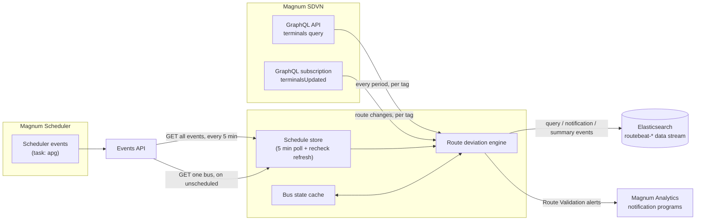
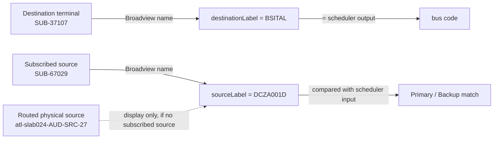
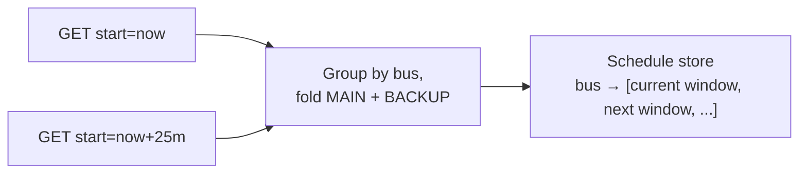
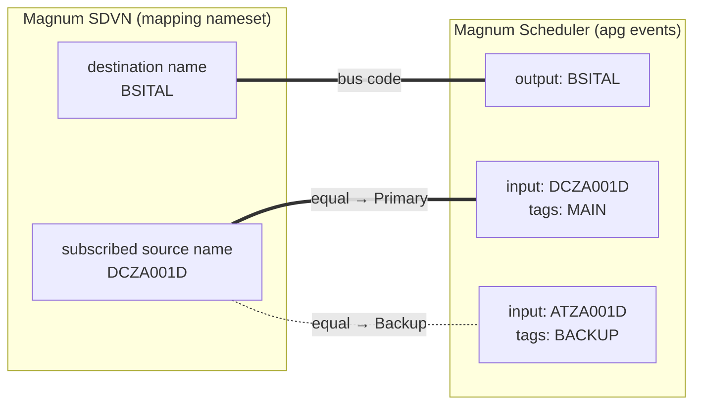
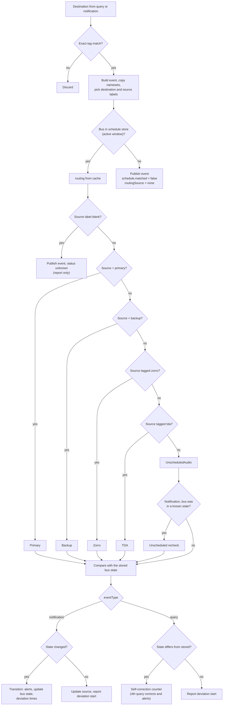
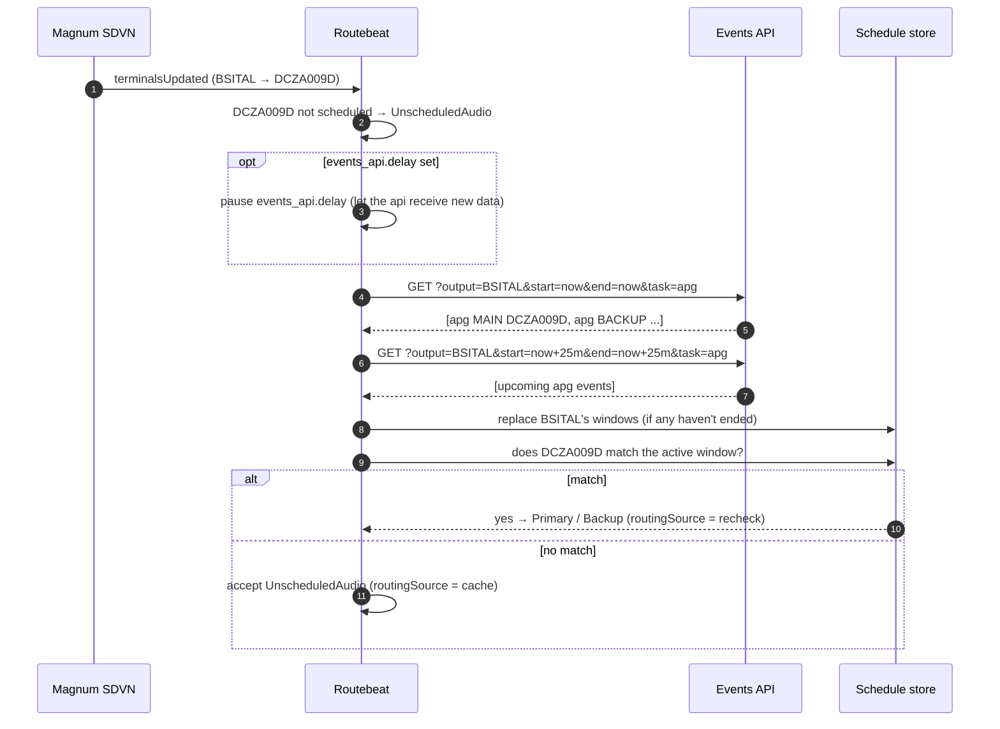
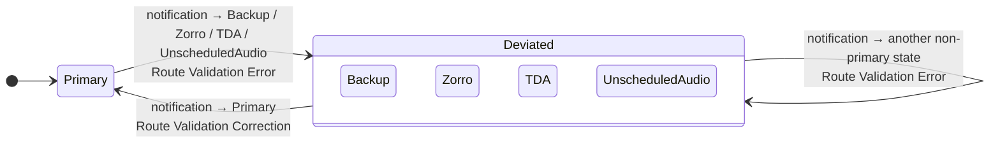
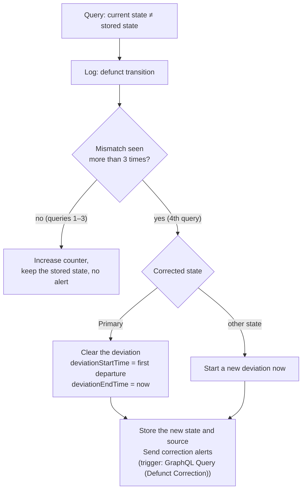

# Routebeat: Route Deviation

Routebeat is an Elastic Beat that watches audio routes in **Magnum SDVN** and checks them against the **Magnum Scheduler**. For every bus (destination) it decides whether the route on air is the scheduled **Primary** source, the scheduled **Backup** source, a known fallback (**Zorro** or **TDA**), or something nobody scheduled (**Unscheduled Audio**).

Every check is published to Elasticsearch as an event. Every change of state is also sent as an alert to the **Magnum Analytics** notification programs, so downstream systems can open and close tickets for route deviations.



---

## Contents

- [Concepts](#concepts)
- [Magnum SDVN: routes](#magnum-sdvn-routes)
  - [Periodic route queries](#periodic-route-queries)
  - [Subscription notifications](#subscription-notifications)
  - [Tag filtering](#tag-filtering)
  - [Nameset filtering and labels](#nameset-filtering-and-labels)
- [Magnum Scheduler: the schedule](#magnum-scheduler-the-schedule)
  - [Scheduler event format](#scheduler-event-format)
  - [Schedule store (events API)](#schedule-store-events-api)
  - [How schedule labels match nameset labels](#how-schedule-labels-match-nameset-labels)
- [Finding route deviation](#finding-route-deviation)
  - [Routing states](#routing-states)
  - [Decision logic](#decision-logic)
  - [Unscheduled recheck](#unscheduled-recheck)
  - [Transitions and deviation times](#transitions-and-deviation-times)
  - [Self-correction when out of sync](#self-correction-when-out-of-sync)
- [Alerts](#alerts)
  - [Alert types](#alert-types)
  - [Notification schema](#notification-schema)
  - [Delivery](#delivery)
- [Event payloads](#event-payloads)
  - [Query and notification events](#query-and-notification-events)
  - [Summary events](#summary-events)
- [Configuration](#configuration)
- [Events API reference](#events-api-reference)
- [Persistence](#persistence)
- [Building, running and testing](#building-running-and-testing)

---

## Concepts

| Term | Meaning |
|---|---|
| **Bus / destination** | A Magnum SDVN destination terminal (`isDst`, `isSub`, `isTlr`) that carries a scheduled audio program. It's identified to the scheduler by its **bus code**, for example `BSITAL`. |
| **Source** | What the destination is subscribed to right now. It's identified by its label in the mapping nameset, for example `DCZA001D`. |
| **Tag** | A Magnum tag (for example `IPAN`) that groups destinations. Routebeat queries and subscribes once per configured tag. |
| **Mapping nameset** | The Magnum nameset (for example `Broadview`) whose names are the labels shared with the scheduler. |
| **Schedule routing** | For a bus and a time window, the scheduled **primary** (`MAIN`) and **backup** (`BACKUP`) source labels. |
| **Deviation** | Any time a bus isn't on its scheduled primary source. |

---

## Magnum SDVN: routes

Routebeat signs in to Magnum with OIDC client credentials (`api.auth`) and talks to the Magnum GraphQL API at `api.url`. It gets routes in two ways, and both feed the same deviation engine:

| | Periodic query | Subscription notification |
|---|---|---|
| GraphQL operation | `query terminals` | `subscription terminalsUpdated` |
| Trigger | every `period`, for each tag | each time Magnum pushes a route change for a tag |
| Event `eventType` | `query` | `notification` |
| Changes the bus state | only to [self-correct](#self-correction-when-out-of-sync) | yes, this is the main way state changes |
| Sends alerts | only on self-correction | yes, on every state change |
| Counters | replaces the tag counters | adjusts the tag counters incrementally |

### Periodic route queries

Every `period` (default 10s), routebeat runs one query per tag. Up to `api.limit` destinations are returned (default 2000). With `api.serialize_queries: true`, the queries for different tags run one at a time to reduce load on the API.

```graphql
query ($limit: Int!, $tag: String!) {
  terminals(input: { filters: [
    { id: "isTlr", booleanValue: true }
    { id: "isDst", booleanValue: true }
    { id: "isSub", booleanValue: true }
    { id: "tags",  listIncludes: [$tag] }
  ]}) {
    totalCount
    edges(limit: $limit) {
      id name tags isSub isDst type
      namesetNames { id name nameset { id name } }
      ... on RouteableTerminal {
        routedPhysicalSource { id name isSrc namesetNames { id name nameset { id name } } }
        subscribedSource     { id name isSub tags namesetNames { id name nameset { id name } } }
      }
    }
  }
}
```

The query is the baseline: every destination is reported on every cycle, so dashboards always show the current state, even if a notification was missed.

### Subscription notifications

When `api.notifications: true`, routebeat opens a GraphQL subscription over a websocket for each tag. The websocket URL is `api.url` with the scheme changed to `wss`. The selection set is the same as the query:

```graphql
subscription ($tag: String!) {
  terminalsUpdated(input: { filters: [ ...same filters as the query... ] }) {
    id name tags isSub isDst type
    namesetNames { ... }
    ... on RouteableTerminal { routedPhysicalSource { ... } subscribedSource { ... } }
  }
}
```

Each message holds the destinations whose routes just changed. These **notification** events drive state transitions and alerts, so routebeat reacts as soon as a route is taken rather than on the next poll.

The subscription is kept alive in these ways:
- When the websocket goes idle (1 minute with no keep-alive), the client reconnects.
- When the client stops, it's restarted for as long as there are active subscriptions.
- If no notification has arrived for `api.sub_reconnect_idle` (default 120m), routebeat closes the client on purpose and resubscribes. This guards against a subscription that looks connected but has silently stopped delivering.

### Tag filtering

The GraphQL `tags` filter (`listIncludes`) can also match tags that only *contain* the configured value. For example, a filter for `MES` can return a destination tagged `MES-2`. Routebeat therefore checks every destination again for an **exact** match of the tag. Destinations that don't match are dropped silently and counted as *discarded* in the debug logs.

### Nameset filtering and labels

Each Magnum terminal has one name per nameset (`namesetNames`). Routebeat uses namesets in two ways.

**1. All namesets are copied onto the event** with lowercase nameset names, so any of them can be searched:

| Terminal | Event field |
|---|---|
| Destination | `dstNameset.<nameset>` |
| Routed physical source | `routeableTerminal.physicalSource.nameset.<nameset>` |
| Subscribed source | `routeableTerminal.subscribedSource.nameset.<nameset>` |

**2. The mapping nameset picks the labels** that are compared with the scheduler. When `mapping.nameset` is set (for example `Broadview`):

| Label | Taken from | When the nameset is missing |
|---|---|---|
| `destinationLabel` | the destination's name in the mapping nameset | `mapping.default` |
| `sourceLabel` | the **subscribed source**'s name in the mapping nameset. If there's no subscribed source, the routed physical source's name is used for display. | `mapping.default` |



Notes:
- The nameset name must match exactly, including case (`Broadview`). The event field names are lowercased (`dstNameset.broadview`).
- **Only the subscribed source's label is used to decide the routing state.** A destination with no subscribed source has no source label to compare, so it's reported as `unknown` (see [Routing states](#routing-states)).
- Without a `mapping` section, no labels are produced and no destination can be matched to the schedule. Events are still published with `schedule.matched: false`.

---

## Magnum Scheduler: the schedule

The Magnum Scheduler decides which source each bus should be on, and when. Routebeat reads its **APG events** (`task: "apg"`) from the scheduler **events API** (`events_api.url`) in two ways, and both update the same **schedule store**:

1. **Schedule poll.** Every `schedule.period` (default 5m), routebeat fetches the events of every bus that are active now and at now + `schedule.lookahead` (default 25m).
2. **Unscheduled recheck.** When a bus has just gone unscheduled, routebeat fetches the latest events for that one bus. This covers fast schedule changes (advances, fast-forwards) that the 5 minute poll would miss.

### Scheduler event format

The scheduler sends one APG event per bus, per window, per role. The same bus and window has one event tagged `MAIN` (the primary source) and one tagged `BACKUP` (the backup source).

```json
{
  "task": "apg",
  "output": "PMQE04",
  "input": "REM546",
  "tags": ["MAIN"],
  "start_date": "2026/08/25 16:00:00",
  "end_date": "2026/08/25 17:00:00",
  "start": "1787673600000000000",
  "end": "1787677200000000000",
  "state": 1,
  "event_id": "d61b2c83-31c4-44a7-9363-4b39dab22f30",
  "schedule_id": "12856158&1787673600000000000",
  "event_params": {
    "apg_id": "37063667",
    "apg_rule": "Pad1Pad2",
    "bus_name": "{event.output}",
    "pri_src": "{event.input}",
    "sec_src": "REM126",
    "historic": true
  },
  "output_type": "magnum", "output_id": "dce1834d-...", "output_pooled": false, "output_blocking": true,
  "input_type": "magnum",  "input_id": "85a25e52-...",  "input_pooled": false,  "input_blocking": false,
  "entry": "manual", "comment": "", "error": "", "history": [], "recur": {},
  "start_offset": "0", "end_offset": "0"
}
```

Fields routebeat uses:

| Field | Meaning | Used as |
|---|---|---|
| `task` | event type | only `apg` is used; everything else is ignored |
| `output` | the bus code (destination) | the schedule key; matched with `destinationLabel` |
| `input` | the scheduled source label | the **primary** when tagged `MAIN`, the **backup** when tagged `BACKUP` |
| `tags` | role of the event | must include `MAIN` or `BACKUP`. Other tags (`EXTERNAL`, `PxP`, ...) can appear alongside them and are ignored |
| `start_date` / `end_date` | the scheduled window, **UTC**, format `YYYY/MM/DD HH:MM:SS` | the event is only used while it's active |
| `start` / `end` | the same window as epoch nanoseconds (JSON numbers) | not used |
| `state` | event state | `7` is a deleted event and is ignored. The API can still return deleted events, often overlapping the event that replaced them |
| `event_params` | scheduler parameters (`pri_src`, `sec_src`, ...) | never used; the sources come only from `input` |

### Schedule store (events API)

Every `schedule.period` (default 5m), routebeat sends two requests to the events API, with no `output`, so every bus is returned. The `task` filter makes the API return only APG events:

```
GET <events_api.url>?end=now&start=now&task=apg
GET <events_api.url>?end=now%2B25m&start=now%2B25m&task=apg
```

The relative times are passed to the API as-is (`+` is sent URL-encoded as `%2B`). The response is a list of events for all buses, ungrouped. Routebeat processes it like this:

1. Anything that isn't an `apg` event is dropped cheaply, before it's fully decoded (a safety net, in case the API ignores the `task` filter).
2. Events not tagged `MAIN` or `BACKUP`, or with dates that can't be read, are dropped.
3. The events are grouped by `output` into **routing windows**. The `MAIN` and `BACKUP` events with the same start and end become one window with a primary and a backup. Windows that only touch (one ends when the next starts) stay separate.
4. The windows from both requests are merged per bus. An event returned by both requests is stored once, and each bus's windows are sorted by start time.



The poll replaces the whole store, so buses that are no longer scheduled are dropped. If the **now** request fails, the store is left as it was; it's never emptied by a failed poll. If only the lookahead request fails, the current windows are still loaded.

When routebeat looks up a bus, it uses the window that's **active right now**, so the store moves to the next program at the top of the hour without waiting for the next poll. If more than one window is active, for example a shorter event scheduled inside a longer one, the window whose start is **closest to now** (the latest start) wins, and windows with the same start resolve to the shorter one. The longer event takes over again when the shorter one ends. With `schedule.dev.validate_end_date: false`, the first stored window is used whatever its dates (for development only). Expired windows are removed every 10 minutes.

The [unscheduled recheck](#unscheduled-recheck) also writes to the store. The refresh returns every event for one bus, so it's handled like the poll, scoped to that bus: the windows are built the same way (`MAIN`/`BACKUP` folded, deleted events skipped) and replace the bus's stored windows. Nothing from the polled windows is carried over, so a `MAIN`-only response leaves the bus with no backup. If the response has no current or upcoming window for the bus, the polled windows are kept. A bus refreshed while a poll is running keeps its refreshed windows, so a poll that started earlier can't overwrite newer data.

The event's `schedule.routingSource` says how the schedule routing was found:

| Value | Meaning |
|---|---|
| `cache` | the schedule store (events API poll) |
| `recheck` | the schedule store, right after an [unscheduled recheck](#unscheduled-recheck) refreshed the bus and the source matched |
| `none` | the bus has no active window in the store |

> `recheck` replaces the `hotcache` value of earlier versions. Update any dashboards or saved searches that filter on `hotcache`.

### How schedule labels match nameset labels

The mapping nameset and the scheduler use the same names. That shared naming is what joins the two systems:



| SDVN (mapping nameset) | Scheduler | Result |
|---|---|---|
| destination name | `output` | finds the bus's schedule |
| subscribed source name = `input` of the `MAIN` event | primary | **Primary** |
| subscribed source name = `input` of the `BACKUP` event | backup | **Backup** |

Labels are compared exactly. A blank source label never matches, even when the schedule has a blank primary or backup.

---

## Finding route deviation

### Routing states

| State | `schedule.status` | Meaning |
|---|---|---|
| Primary | `Primary` | on the scheduled primary (`MAIN`) source |
| Backup | `Backup` | on the scheduled backup (`BACKUP`) source |
| Zorro | `Zorro` | on a source carrying the configured `zorro` tag (a known fallback) |
| TDA | `TDA` | on a source carrying the configured `tda` tag (a known fallback) |
| Unscheduled | `UnscheduledAudio` | on a source that's neither scheduled nor a known fallback |
| Unknown | `unknown` | the destination has no subscribed source label, so no state can be decided. These events are **report-only**: they don't change the stored bus state, send alerts or affect counters |

A label match always wins over a tag match. A source that is the scheduled primary and also carries the Zorro tag is **Primary**.

### Decision logic



### Unscheduled recheck

`UnscheduledAudio` is often a false alarm: the scheduler has just moved the bus to a new source, and the routebeat schedule hasn't caught up yet. When a **notification** moves a bus from a known state into `UnscheduledAudio`, routebeat refreshes that bus from the events API and checks again before reporting it:



- If the events API is slow to receive new scheduler data, set `events_api.delay`. Routebeat then pauses that long before calling the API, so the request is more likely to include the change that just happened.
- If the API is down or returns an error, the store isn't changed and the source is checked against the polled window, which normally means `UnscheduledAudio` is accepted.
- The refresh replaces the bus's windows only when the response has a current or upcoming window for it. An empty response keeps the polled windows.
- Events for other buses in the response are ignored; the poll keeps those current.
- When there's no match, the event reports the routing the status was decided against, even if the refresh stored a newer window.
- The recheck never runs for queries, for buses seen for the first time, or for buses already unscheduled.
- The recheck sends the same two requests as the poll (now, then now + `schedule.lookahead`), filtered to the bus with `output`. A start and end are always sent: without them the API returns every event it holds for the bus (the previous day and the next 6 days). If the now request fails, the lookahead request isn't sent and the store isn't changed. If only the lookahead request fails, the current window is still applied.
- A recheck delays the destinations after it in the same batch by up to `events_api.delay` plus twice `events_api.timeout` (two requests).
- Each bus is processed one notification or query at a time. Subscription messages are handled concurrently, so a second notification for a bus that arrives during its recheck waits for the recheck to finish, then sees the stored `UnscheduledAudio`. It doesn't run a second recheck or send the alerts again. Other buses aren't blocked. A query for that bus also waits, which delays the rest of that query batch once.

### Transitions and deviation times

Routebeat stores a **bus state** for every bus: the last state, the source label, and the deviation times. A notification that changes the state is a **transition**:



On every transition routebeat:
1. Sends the [alerts](#alerts): one closing the previous state and one opening the new state.
2. Moves the tag counters from the previous state to the new one.
3. Sets `schedule.deviationStartTime` to the time of the change.
4. On a return to **Primary**, sets `schedule.deviationStartTime` to when the bus *first* left Primary and `schedule.deviationEndTime` to now, then clears the deviation.

| Event | `deviationStartTime` | `deviationEndTime` |
|---|---|---|
| Notification, deviation begins or continues to another state | time of this change | not set |
| Notification, return to Primary | when the bus first left Primary | now |
| Notification or query, no change, bus deviated | time of the last change | not set |
| Notification or query, no change, bus on Primary | `-` | not set |
| Query that self-corrects to Primary | when the bus first left Primary | now |

### Self-correction when out of sync

A query only reports state: it never changes the bus state the first time it disagrees with it. Notifications drive transitions. However, notifications can be missed (a dropped websocket, a restart, or a route changed while routebeat was down), and around the top of the hour a query may be processed before the notification for the same change. In those cases, the stored state can get out of step with what's on air.

Routebeat corrects itself with a counter:



- Three queries in a row (3 × `period`) give a late notification time to arrive and make the change the normal way.
- On the fourth query, the stored state is overwritten and the same pair of previous/current alerts is sent as for a normal transition, so downstream tickets stay in step. These alerts have `eventType: query` and the trigger `GraphQL Query (Defunct Correction)`.
- Counters aren't moved between states during a correction; the next query cycle rebuilds the counters from scratch.

---

## Alerts

### Alert types

Every transition, and every self-correction, sends **two** alerts (only the *current* one when the bus has no earlier state):

| Classification tag | Purpose | `details.status` | `start` | `end` |
|---|---|---|---|---|
| `previous` | closes the ticket for the old state | the old state | when the old state began (or `-`) | time of the change |
| `current` | opens a ticket for the new state | the new state | time of the change | empty |

The message type depends on the **new** state:

| New state | Summary | Body | `context.basic[].type` |
|---|---|---|---|
| Backup, Zorro, TDA, UnscheduledAudio | `[Route Validation Error] Route validation transition from Primary` | `Route validation transition status from primary to another status` | `Event - Status Changed` |
| Primary | `[Route Validation Correction] Route validation transition to Primary` | `Route validation transition status to primary from another status` | `Event - Status Reverted` |

Triggers (`details.trigger`):

| Trigger | Sent when |
|---|---|
| `GraphQL Subscription (Previous State)` / `GraphQL Subscription (Current State)` | a subscription notification changed the state |
| `GraphQL Query (Defunct Correction) (Previous State)` / `GraphQL Query (Defunct Correction) (Current State)` | a query [self-corrected](#self-correction-when-out-of-sync) the state |

### Notification schema

Alerts use the **Magnum Analytics notification schema, version 2.0**:

```json
{
  "message": {
    "summary": "[Route Validation Error] Route validation transition from Primary",
    "body": "Route validation transition status from primary to another status"
  },
  "unique": {
    "uid": "6c1f4a0e-9a53-4d0b-9c9b-2f6d1f1f8d3a",
    "expiry": -1
  },
  "classification": {
    "severity": "critical",
    "priority": 1,
    "category": "category-3",
    "category_label": "",
    "tags": ["current"]
  },
  "origin": {
    "detector": { "host": "routebeat-host-01", "app": "routebeat" }
  },
  "context": {
    "basic": [
      {
        "type": "Event - Status Changed",
        "details": {
          "status": "Zorro",
          "busname": "BSITAL",
          "source": "LOOP67PP",
          "start": "2026-07-16T18:08:15Z",
          "end": "",
          "eventType": "notification",
          "tags": "SOURCE,IPAN,DESTINATION",
          "trigger": "GraphQL Subscription (Current State)"
        }
      }
    ],
    "detailed": [ { "type": "Event - Status Changed" } ]
  },
  "version": "2.0"
}
```

| Field | Value |
|---|---|
| `unique.uid` | a new UUID per alert |
| `unique.expiry` | `-1` (never expires) |
| `classification.severity` / `priority` / `category` | always `critical` / `1` / `category-3` |
| `classification.tags` | `["previous"]` or `["current"]` |
| `origin.detector.host` | the host name of the machine running routebeat |
| `origin.detector.app` | `routebeat` |
| `details.status` | routing state, as in `schedule.status` |
| `details.busname` | bus code (`destinationLabel`) |
| `details.source` | source label for that state |
| `details.start` / `details.end` | RFC3339 UTC times, `-` if unknown, empty if still open |
| `details.eventType` | `notification`, or `query` for self-corrections |
| `details.tags` | the destination's Magnum tags, comma separated (on `current` alerts only) |
| `details.trigger` | see [Alert types](#alert-types) |

### Delivery

Each alert is POSTed as JSON to every configured notification program, at `https://<node>:<port>/api/-/notify`. The programs are found in one of two ways:

- **manual** (`notifiers.manual`): a fixed list of `node` / `port` pairs.
- **auto** (`notifiers.auto`): routebeat signs in to Magnum Analytics at `host` and looks up each `types` entry (default `notification-elastic`) with `GET https://<host>/api/-/model/nature/locator/by-type?type=<type>`. The response's `ip` and `port` give the endpoint.

If neither is set, alerts are still built (and their deviation times are still recorded), but they aren't sent. Alerts are sent in the background, so a slow notification program doesn't hold up event publishing.

---

## Event payloads

Routebeat publishes three kinds of events. `eventType` tells them apart.

### Query and notification events

One event per destination, per query or notification:

```json
{
  "@timestamp": "2026-07-16T18:08:15.984Z",
  "eventType": "notification",
  "dstTag": "IPAN",
  "dstId": "af2925a1-a72f-5355-a5d5-c3ec7f5de929",
  "dstName": "SUB-37107",
  "dstType": "sub",
  "dstIsSub": true,
  "dstIsDst": true,
  "dstTags": ["SOURCE", "IPAN", "DESTINATION", "Scheduler: Active"],
  "dstNameset": {
    "broadview": "BSITAL",
    "eng": "DSTSUB_IAD_WEB 096"
  },
  "destinationLabel": "BSITAL",
  "sourceLabel": "LOOP67PP",
  "routeableTerminal": {
    "physicalSource": {
      "name": "atl-slab024-AUD-SRC-27",
      "isSrc": true
    },
    "subscribedSource": {
      "name": "SUB-67029",
      "isSub": true,
      "nameset": { "broadview": "LOOP67PP", "eng": "SRCSUB_ATL ZORRO 2_19" }
    }
  },
  "schedule": {
    "buscode": "BSITAL",
    "status": "Zorro",
    "primary": "DCZA001D",
    "backup": "ATZA001D",
    "matched": true,
    "routingSource": "cache",
    "deviationStartTime": "2026-07-16T18:08:15Z"
  }
}
```

| Field | Type | Description |
|---|---|---|
| `eventType` | keyword | `query` or `notification` |
| `dstTag` | keyword | the configured tag that produced the event |
| `dstId`, `dstName`, `dstType` | keyword | Magnum destination ID, name and type |
| `dstIsSub`, `dstIsDst` | boolean | Magnum destination flags |
| `dstTags` | keyword[] | all Magnum tags on the destination |
| `dstNameset.<nameset>` | object | destination name in every nameset (nameset names lowercased) |
| `destinationLabel` | keyword | destination name in the mapping nameset (the bus code) |
| `sourceLabel` | keyword | source name in the mapping nameset |
| `routeableTerminal.physicalSource` | object | routed physical source: `name`, `isSrc`, `nameset.<nameset>` |
| `routeableTerminal.subscribedSource` | object | subscribed source: `name`, `isSub`, `nameset.<nameset>` |
| `schedule.buscode` | keyword | bus code looked up in the schedule |
| `schedule.status` | keyword | `Primary`, `Backup`, `Zorro`, `TDA`, `UnscheduledAudio` or `unknown` |
| `schedule.primary` / `schedule.backup` | keyword | scheduled primary (`MAIN`) and backup (`BACKUP`) source labels |
| `schedule.matched` | boolean | `false` when the bus isn't in the schedule |
| `schedule.routingSource` | keyword | `cache`, `recheck` or `none` |
| `schedule.deviationStartTime` | keyword | RFC3339 start of the current deviation, or `-` (see [deviation times](#transitions-and-deviation-times)) |
| `schedule.deviationEndTime` | keyword | RFC3339 end of a deviation; only set on the event that returns the bus to Primary |

Variations:
- **Unmatched bus:** `schedule` only contains `matched: false` and `routingSource: "none"`.
- **No source at all:** `routeableTerminal` is removed.
- **Unknown state:** `schedule.status: "unknown"`, with no deviation times.

### Summary events

After each query or notification batch, routebeat publishes a summary for the tag. After each query batch it also publishes a `global` summary across all tags:

```json
{
  "@timestamp": "2026-07-16T18:08:16.002Z",
  "eventType": "summary",
  "dstTag": "IPAN",
  "counters": {
    "Primary": 412,
    "Backup": 6,
    "Zorro": 3,
    "TDA": 1,
    "UnscheduledAudio": 2,
    "processed": 431,
    "unmatched": 7
  }
}
```

| Field | Description |
|---|---|
| `dstTag` | the tag, or `global` for the total across all tags |
| `counters.Primary` ... `counters.UnscheduledAudio` | destinations currently in each state |
| `counters.processed` | destinations processed in this batch (tag summaries only) |
| `counters.unmatched` | destinations not found in the schedule in this batch (tag summaries only) |

Query batches set the state counters to exact values. Notification batches adjust them incrementally until the next query.

---

## Configuration

`routebeat.yml`:

```yaml
routebeat:
  period: 30s
  tags: ["IPAN"]

  mapping:
    nameset: "Broadview"
    default: ""

  zorro: "ZORRO"
  tda: "TDA"

  api:
    url: "https://<magnum>/graphql/v1.1"
    notifications: true
    limit: 2000
    serialize_queries: false
    timeout: 10s
    sub_reconnect_idle: 120m
    auth:
      client_id: "<client id>"
      client_secret: "<secret>"
      token_url: "https://<magnum>/auth/realms/magnum/protocol/openid-connect/token"

  schedule:
    period: 5m
    lookahead: 25m

  events_api:
    url: "http://<scheduler-events>/api/v1/scheduler/events"
    # task: apg
    # timeout: 3s
    # bulk_timeout: 15s
    # delay: 0s
    # headers:
    #   Authorization: "Bearer <token>"

  notifiers:
    auto:
      host: "<magnum analytics>"
      username: "admin"
      password: "admin"
      types: ["notification-elastic"]
    # manual:
    #   - node: "<ip>"
    #     port: 19708
```

| Option | Default | Description |
|---|---|---|
| `period` | `10s` | how often each tag is queried |
| `tags` | *(required)* | Magnum tags to query and subscribe to; at least one |
| `mapping.nameset` | *(none)* | mapping nameset for the destination and source labels; required if `mapping` is present |
| `mapping.default` | `""` | label used when a terminal has no name in the mapping nameset |
| `zorro` | `""` | source tag that marks a source as **Zorro** |
| `tda` | `""` | source tag that marks a source as **TDA** |
| **`api`** | | **Magnum SDVN GraphQL** |
| `api.url` | | GraphQL endpoint; the subscription uses the same URL with `wss` |
| `api.notifications` | `true` | turn subscription notifications on or off |
| `api.limit` | `2000` | maximum destinations returned per query |
| `api.serialize_queries` | `false` | run the per-tag queries one at a time |
| `api.timeout` | `10s` | query timeout |
| `api.sub_reconnect_idle` | `120m` | resubscribe after this long with no notifications |
| `api.auth.client_id` / `client_secret` / `token_url` | | Magnum OIDC client credentials |
| **`schedule`** | | **Schedule store** |
| `schedule.period` | `5m` | how often every bus's events are fetched from the events API |
| `schedule.lookahead` | `25m` | each poll also fetches the events active at now + lookahead, so the next window is stored before it starts |
| `schedule.dev.load_cache` | `false` | development: use the saved `scheduleStore.gob` and don't poll the events API |
| `schedule.dev.validate_end_date` | `true` | only use schedule windows that are active now |
| **`events_api`** | | **Scheduler events API** (required) |
| `events_api.url` | *(required)* | events endpoint. Query parameters are added to any already in the URL; the `{output}` path placeholder isn't supported |
| `events_api.start_param` / `end_param` | `start` / `end` | query parameter names for the poll's point in time |
| `events_api.output_param` | `output` | query parameter name for the bus code in a recheck |
| `events_api.task_param` / `task` | `task` / `apg` | task filter sent with every request; an empty `task` sends no filter |
| `events_api.timeout` | `3s` | timeout for each of the two recheck requests |
| `events_api.bulk_timeout` | `15s` | poll request timeout (each poll response holds every bus) |
| `events_api.delay` | `0s` | pause before each recheck request, in case the API is slow to receive new scheduler data; `0s` calls the API immediately |
| `events_api.headers` | | extra request headers, for example authorization |
| **`notifiers`** | | **Alert delivery** (`manual` takes priority over `auto`) |
| `notifiers.manual[].node` / `port` | | fixed notification program endpoints |
| `notifiers.auto.host` | | Magnum Analytics host used for program lookup |
| `notifiers.auto.username` / `password` | `admin` / `admin` | Magnum Analytics credentials |
| `notifiers.auto.types` | `["notification-elastic"]` | program types to look up |

The `elasticsearch` and `webhook` sections of earlier versions have been removed. If an old config still has them, they're ignored and a warning is logged at startup.

---

## Events API reference

Every request is a `GET` with an `Accept: application/json` header and any configured `events_api.headers`. The response body must be a JSON array of scheduler events (a single event object is also accepted). A non-`2xx` status, a timeout, a connection error or a malformed body is logged as an error and changes nothing.

| Request | When | Example (default parameter names) |
|---|---|---|
| poll, now | every `schedule.period` | `GET <url>?end=now&start=now&task=apg` |
| poll, lookahead | right after the first poll request | `GET <url>?end=now%2B25m&start=now%2B25m&task=apg` |
| recheck, now | a bus has just gone unscheduled | `GET <url>?end=now&output=BSITAL&start=now&task=apg` |
| recheck, lookahead | right after the first recheck request | `GET <url>?end=now%2B25m&output=BSITAL&start=now%2B25m&task=apg` |

Every 5 minutes, routebeat logs counts of the events received, skipped and stored under the `ScheduleEvents` [debug selector](#debug-logging).

A mock events API for testing is included. It returns a `MAIN` and `BACKUP` event per bus, for the `-outputs` buses on a poll and for the requested bus on a recheck, active around the requested time:

```bash
go run ./tools/mock_events_api -addr :8090 -primary DCXA006D -outputs BSITAL,BSTRJA   # backup is a random REM### per request
```
```yaml
events_api:
  url: "http://localhost:8090/events"
```

---

## Persistence

| File | Content | Saved | Loaded |
|---|---|---|---|
| `busCache.gob` | stored state, source and deviation times for every bus | every 10 minutes and on shutdown | at startup |
| `scheduleStore.gob` | schedule store windows (expired windows are dropped before saving) | every 10 minutes and on shutdown | at startup, so the schedule is available before the first poll; windows that ended while routebeat was down are dropped |

Because the bus cache is saved, an open deviation keeps its start time across restarts. Any change missed while routebeat was down is fixed by [self-correction](#self-correction-when-out-of-sync).

---

## Building, running and testing

```bash
make                                    # build ./routebeat
./routebeat -c routebeat.yml -e -d "*"  # run with debug logging
```

### Debug logging

Routebeat's debug messages are grouped under **selectors**. Choose which ones to show with `-d`. Use a comma-separated list, or `"*"` for every selector, including the libbeat ones:

```bash
./routebeat -c routebeat.yml -e -d "ProcessResults.Notifications,ScheduleCache,ScheduleRecheck"
```

or in `routebeat.yml`:

```yaml
logging.level: debug
logging.selectors: ["ProcessResults.*", "ScheduleCache", "ScheduleRecheck"]
```

| Selector | What it logs | Use it to |
|---|---|---|
| `ProcessResults.Query`<br>`ProcessResults.Notifications` | For each batch of that event type (periodic query or subscription notification): the tag, number of destinations and event type; then the totals of **processed**, **discarded** (tag didn't match exactly), **unmatched** (not in the schedule) and **expired**; and how many alerts were sent for the tag. Notification batches also list the destinations they contained (`Destinations: BSITAL,BSTRJA`, using the mapping nameset label, or the Magnum destination name without mapping); query batches only log totals. `ProcessResults.*` or `ProcessResults` turns on both (see below) | follow each poll or each subscription message on its own, and see how many destinations matched the schedule |
| `ScheduleCache` | For every destination that matched a schedule: the destination and source labels, the routing source (`cache` or `recheck`), and the schedule found (primary, backup, window) | find out why a bus got a particular status: compare its source label with the scheduled primary and backup |
| `ScheduleRecheck` | An unscheduled recheck refreshed the bus and found a routing that matches the source. It uses the same fixed `Key:value` format as `ScheduleRecheckMiss`, with `State` in place of `Reason`:<br>`Recheck hit Destination:<bus> Source:<source label> State:<Primary\|Backup> Primary:<primary> Backup:<backup>` | confirm that the events API refresh rescued a bus from `UnscheduledAudio` |
| `ScheduleRecheckMiss` | Each unscheduled recheck that doesn't find a match, in a fixed `Key:value` format:<br>`Recheck miss Destination:<bus> Source:<source label> Reason:<no_active_routing\|source_not_scheduled> Primary:<primary> Backup:<backup>`<br>`no_active_routing` means the store has no active window for the bus after the refresh, and Primary and Backup are blank. `source_not_scheduled` means an active window exists but the source is neither its primary nor its backup. | find buses the recheck couldn't rescue, and collect the destination and source pairs, for example to check later what the events API should have returned |
| `QueryScheduler` | After each schedule poll: the number of events returned for now and for the lookahead, the number of buses stored, and how many buses were kept because a recheck refreshed them during the poll | check that the poll is running and returning the expected number of buses |
| `ScheduleEvents` | Every 5 minutes, counters for the previous 5 minutes of poll and recheck responses: `events` (`apg` events decoded), `non-apg` (dropped as another task or shape), `invalid` (bad JSON or dates), `deleted` (`state: 7` deleted events, skipped), `apg-no-tag` (no `MAIN`/`BACKUP` tag), `routings` (windows built) | check what the events API is returning, and why events are or aren't reaching the schedule |
| `PruneSchedule` | Every 10 minutes, the number of expired windows and empty buses removed from the schedule store | confirm that old windows are dropped |

Libbeat matches selectors exactly; the only wildcard it understands is `*`. Routebeat adds its own handling for the `ProcessResults` group:

| Selectors set | Query batch logs | Notification batch logs |
|---|---|---|
| `ProcessResults.Query` | yes, as `ProcessResults.Query` | no |
| `ProcessResults.Notifications` | no | yes, as `ProcessResults.Notifications` |
| `ProcessResults.*` | yes, as `ProcessResults.*` | yes, as `ProcessResults.*` |
| `ProcessResults` | yes, as `ProcessResults` | yes, as `ProcessResults` |
| `*` | yes, as `ProcessResults.Query` | yes, as `ProcessResults.Notifications` |

A log line carries the name of the selector that let it through. With `ProcessResults.*` or `ProcessResults` set, both event types show that name, so use the `EventType` field in the message to tell them apart. `ProcessResults.*` is only understood for this group; other `.*` patterns match nothing.

Info, warning and error messages are always logged, whatever selectors are set. These include defunct-state warnings and self-corrections, events API and schedule poll failures, subscription reconnects and alert delivery errors.

### Updating generated files

After changing `_meta/fields.yml` or `_meta/config/*.tmpl`, regenerate the field docs and reference configs:

```bash
make update
```

`make update` also regenerates `routebeat.yml`, so back up a customised local file first.

Unit tests (with the race detector):

```bash
go test -race -count=1 ./beater/... ./config/
```

For a description of every test of the deviation logic, see **[Route Deviation Tests](docs/route-deviation-tests.md)**.

The tests include replays of real lab data in `beater/testdata/`: scheduler events from the events API, and routebeat status documents and notification sequences from Elasticsearch. To refresh them (read-only):

```bash
# scheduler events from the events API (or --events-file <saved response>)
python3 -I beater/testdata/fetch_fixtures.py scheduler --events-api https://<host>:20000/api/v1/scheduler/events --insecure

# routebeat documents and notification sequences from Elasticsearch
python3 -I beater/testdata/fetch_fixtures.py routebeat --es http://<elasticsearch>:9200
```
