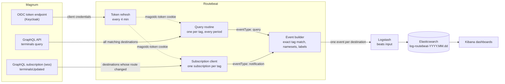
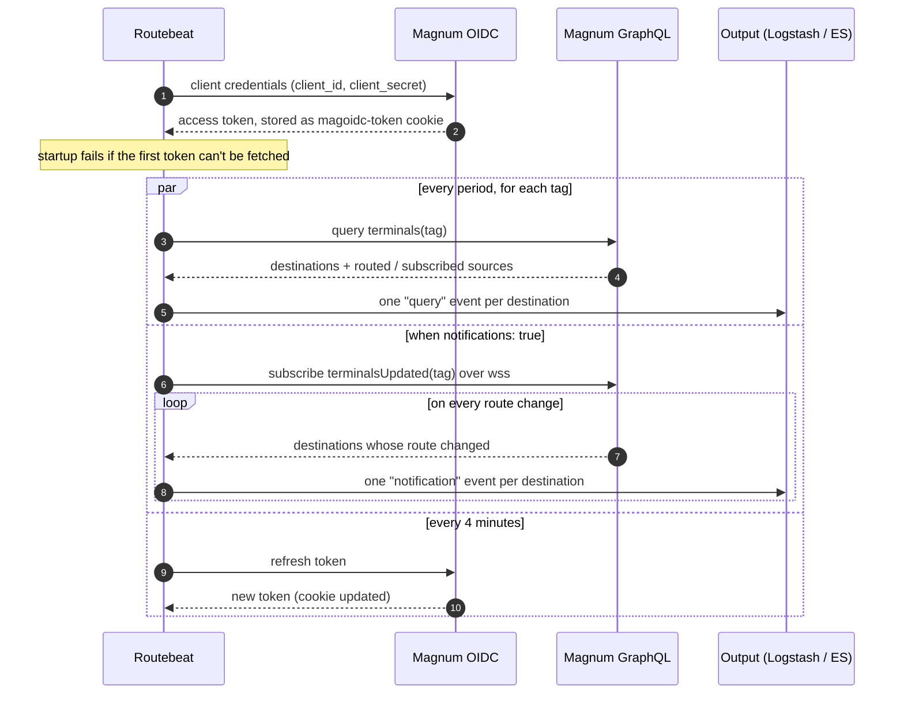
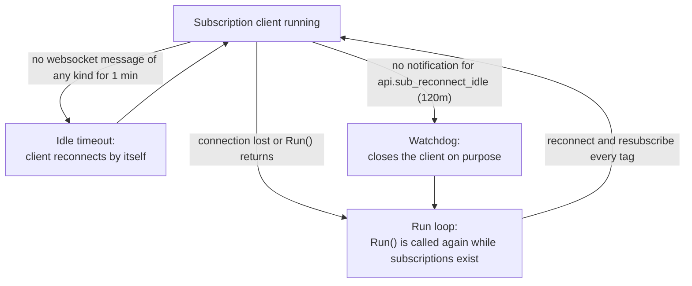
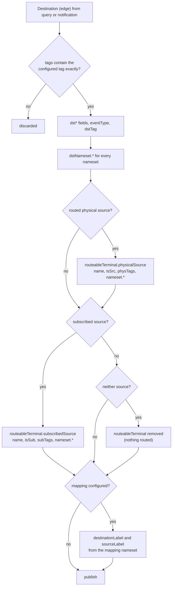
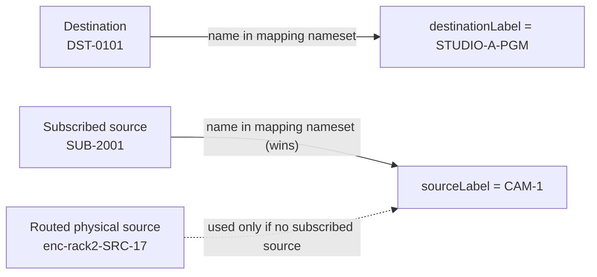
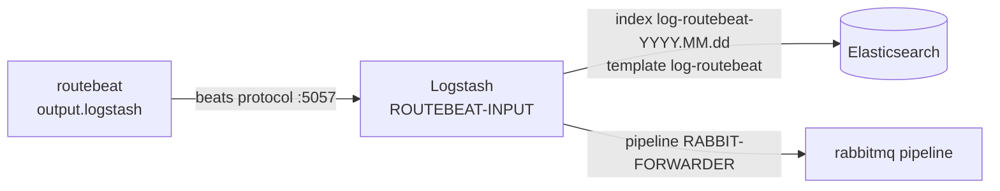

# Routebeat

Routebeat is an Elastic Beat that collects **routing state from Magnum SDVN**. For every destination carrying one of the configured tags, it reports what is routed to it: the routed physical source, the subscribed source, and the names of each in every Magnum nameset. Each report becomes an event in Elasticsearch, so Kibana dashboards can show what is on air at any destination and how routes changed over time.

Routebeat gets the data in two ways:

- **Periodic queries:** every `period`, a GraphQL query per tag returns the current route of every matching destination. This is the baseline, so dashboards always show the current state even if a change was missed.
- **Subscription notifications** (optional): a GraphQL subscription per tag delivers destinations the moment their route changes, so changes show up without waiting for the next poll.



## Contents

- [How it works](#how-it-works)
  - [Authentication](#authentication)
  - [Periodic route queries](#periodic-route-queries)
  - [Subscription notifications](#subscription-notifications)
  - [Keeping the subscription alive](#keeping-the-subscription-alive)
  - [Tag matching](#tag-matching)
  - [Building events](#building-events)
- [Data it generates](#data-it-generates)
  - [Event types](#event-types)
  - [Fields](#fields)
  - [Example event](#example-event)
  - [Where the data goes](#where-the-data-goes)
- [Configuration](#configuration)
- [Running as a service](#running-as-a-service)
- [Development](#development)
- [Building on Beats 8.19.25](#building-on-beats-81925)
- [Packaging](#packaging)

## How it works



### Authentication

At startup routebeat requests an access token from the Magnum OIDC token endpoint (`api.auth.token_url`) with the OAuth2 client credentials flow. The token is stored as the `magoidc-token` cookie, which the GraphQL query client and the subscription websocket both send. A background routine fetches a new token every 4 minutes. If the first token can't be fetched, routebeat exits with an authentication error. A failed refresh is logged and retried on the next tick.

> TLS certificate verification is turned off for all HTTPS and websocket connections, because Magnum servers commonly use self-signed certificates.

### Periodic route queries

For each tag, routebeat runs its own query routine. Every `period` (the first run is one period after startup), it asks for up to `api.limit` destinations:

```graphql
query ($limit: Int!, $tag: String!) {
  terminals(input: { filters: [
    { id: "isTlr", booleanValue: true }
    { id: "isDst", booleanValue: true }
    { id: "isSub", booleanValue: true }
    { id: "tags",  listIncludes: [$tag] }
  ]}) {
    totalCount
    edges(limit: $limit) {
      id name tags isSub isDst type
      namesetNames { id name nameset { id name } }
      ... on RouteableTerminal {
        routedPhysicalSource { id name isSrc tags namesetNames { id name nameset { id name } } }
        subscribedSource     { id name isSub tags namesetNames { id name nameset { id name } } }
      }
    }
  }
}
```

The full query, with variables, is in [beater/models_graphql.go](beater/models_graphql.go). The `$tag` variable is sent wrapped in double quotes (for example `"IPAN"`), so `listIncludes` matches the whole tag. A query that times out (10 seconds) or fails is logged and tried again on the next period. A query with no results is logged and publishes nothing.

### Subscription notifications

With `api.notifications: true` (the default), routebeat also opens a GraphQL subscription for each tag. All subscriptions share one websocket, whose URL is `api.url` with the scheme changed to `wss`. The subscription uses the same filters and selection set as the query. Each message holds only the destinations whose route just changed, and each becomes a `notification` event.

### Keeping the subscription alive

Websocket subscriptions can drop, or stay connected while silently stopping delivery. Routebeat has three layers of recovery:



1. **Idle timeout:** if the websocket receives nothing at all (not even a keep-alive) for 1 minute, the client treats the connection as stale and reconnects.
2. **Run loop:** whenever the client stops, it's started again, for as long as there are subscriptions. The subscriptions are kept, so each restart resubscribes every tag.
3. **Watchdog:** if no notification has arrived for `api.sub_reconnect_idle` (default 120m), routebeat closes the client on purpose, and the run loop reconnects. This catches a subscription that looks healthy but has stopped delivering. Set `sub_reconnect_idle: 0` to turn the watchdog off, for example on a system where routes rarely change.

Even if notifications stop for a while, the periodic query still reports every destination each period.

### Tag matching

Magnum's GraphQL tag filter has been known to return destinations whose tags only *contain* the configured value. For example, a filter for `MES` could return a destination tagged `MES-2`. Routebeat therefore checks every returned destination again for an **exact** match on one of its tags. Destinations that don't match are dropped and counted as *discarded* in the debug log (`-d "ProcessResults"`).

### Building events

Each matching destination becomes one event:



Nameset names are lowercased in field names: a nameset called `Broadview` becomes `dstNameset.broadview`. The `mapping.nameset` setting must still match the Magnum nameset name exactly, including case.

**Labels.** When `mapping` is configured, routebeat adds two convenience fields, taken from the `mapping.nameset` nameset:

| Field | Value | When the name is missing |
|---|---|---|
| `destinationLabel` | the destination's name in the mapping nameset | `mapping.default` |
| `sourceLabel` | the **subscribed source**'s name in the mapping nameset; if there's no subscribed source, the **routed physical source**'s name | `mapping.default` (also used when nothing is routed) |



## Data it generates

### Event types

| `eventType` | Produced by | How often | Contains |
|---|---|---|---|
| `query` | Periodic query | Every `period`, for each tag | Every matching destination, routed or not |
| `notification` | Subscription | Whenever Magnum reports a route change | Only the destinations that changed |

There's one event per destination per tag. A destination that carries two configured tags is reported once for each tag, with a different `dstTag`. Expect about `destinations × (86400 / period)` query events per day. For example, 500 destinations at a 30 s period is about 1.44 million events a day, plus notifications.

### Fields

Routebeat's own fields are at the top level of the event:

| Field | Type | Description |
|---|---|---|
| `dstId` | keyword | Magnum destination terminal ID |
| `dstName` | keyword | Destination terminal name |
| `dstIsSub` | boolean | The destination is a subscription terminal |
| `dstIsDst` | boolean | The destination is a destination terminal |
| `dstType` | keyword | Magnum terminal type (for example `RouteableTerminal`) |
| `dstTags` | keyword[] | All tags on the destination |
| `dstTag` | keyword | The configured tag this event was collected for |
| `dstNameset.<nameset>` | keyword | Destination name in each nameset (lowercased nameset name) |
| `eventType` | keyword | `query` or `notification` |
| `routeableTerminal.physicalSource.name` | keyword | Routed physical source name |
| `routeableTerminal.physicalSource.isSrc` | boolean | The physical source is a source terminal |
| `routeableTerminal.physicalSource.physTags` | keyword[] | Tags on the physical source (only when it has tags) |
| `routeableTerminal.physicalSource.nameset.<nameset>` | keyword | Physical source name in each nameset |
| `routeableTerminal.subscribedSource.name` | keyword | Subscribed source name |
| `routeableTerminal.subscribedSource.isSub` | boolean | The source is a subscription terminal |
| `routeableTerminal.subscribedSource.subTags` | keyword[] | Tags on the subscribed source (only when it has tags) |
| `routeableTerminal.subscribedSource.nameset.<nameset>` | keyword | Subscribed source name in each nameset |
| `destinationLabel` | keyword | Destination name in `mapping.nameset` (only with `mapping`) |
| `sourceLabel` | keyword | Source name in `mapping.nameset` (only with `mapping`) |

`routeableTerminal` is left out when the destination has neither a routed physical source nor a subscribed source. Each sub-object is left out when that source is missing. Events also carry the standard Beats fields (`@timestamp`, `agent.*`, `ecs.*`) and the `host.*` and `cloud.*` metadata added by the processors in `routebeat.yml`. The field definitions are in [_meta/fields.yml](_meta/fields.yml), and [docs/fields.asciidoc](docs/fields.asciidoc) is generated from them.

### Example event

A `query` event for a destination with a subscribed source and a routed physical source, with `mapping.nameset: Broadview` (the names are illustrative; standard Beats fields are left out):

```json
{
  "@timestamp": "2026-11-26T16:00:00.000Z",
  "eventType": "query",
  "dstId": "a1b2c3d4-0101",
  "dstName": "DST-0101",
  "dstIsSub": true,
  "dstIsDst": true,
  "dstType": "RouteableTerminal",
  "dstTags": ["IPAN", "STUDIO-A"],
  "dstTag": "IPAN",
  "dstNameset": {
    "broadview": "STUDIO-A-PGM",
    "default": "DST-0101"
  },
  "routeableTerminal": {
    "physicalSource": {
      "name": "enc-rack2-SRC-17",
      "isSrc": true,
      "physTags": ["ENCODERS"],
      "nameset": { "broadview": "ENC-17", "default": "enc-rack2-SRC-17" }
    },
    "subscribedSource": {
      "name": "SUB-2001",
      "isSub": true,
      "subTags": ["CAMERAS"],
      "nameset": { "broadview": "CAM-1", "default": "SUB-2001" }
    }
  },
  "destinationLabel": "STUDIO-A-PGM",
  "sourceLabel": "CAM-1"
}
```

### Where the data goes

Routebeat can send to Elasticsearch directly (`output.elasticsearch`, the packaged default) or through Logstash (`output.logstash`). The deployment in [logstash/](logstash/) uses Logstash:



- [logstash/logstash.conf](logstash/logstash.conf): beats input on port 5057, written to the daily index `log-routebeat-YYYY.MM.dd`, and forwarded to the `rabbitmq` pipeline.
- [logstash/elasticsearch-template-routebeat.json](logstash/elasticsearch-template-routebeat.json): the index template for `log-routebeat-*`. It started as a `./routebeat export template` export but has its own index pattern, priority and settings, so don't regenerate it: when you add a field to `_meta/fields.yml`, add its mapping here too.

When sending directly to Elasticsearch, routebeat writes to the `routebeat-<version>` data stream (`routebeat-8.19.25` for this release). Load the index template (`routebeat setup --index-management`) before the first run.

## Configuration

Routebeat's settings are under `routebeat:` in [routebeat.yml](routebeat.yml); [routebeat.reference.yml](routebeat.reference.yml) lists every option. The files are generated from [_meta/config/](_meta/config/), so make permanent changes there.

```yaml
routebeat:
  period: 30s              # how often each tag is queried
  tags:                    # at least one tag is required
    - "MES"
    - "IPAN"

  mapping:                 # optional: adds destinationLabel / sourceLabel
    nameset: "Broadview"   # Magnum nameset name, exact case; required when mapping is set
    default: ""            # value used when a name is missing or nothing is routed

  api:
    url: "https://<magnum>/graphql/v1.1"
    notifications: true    # subscribe to route changes
    limit: 2000            # max destinations per query
    sub_reconnect_idle: 120m   # watchdog; 0 disables it
    auth:
      client_id: "<client id>"
      client_secret: "<client secret>"
      token_url: "https://<magnum>/auth/realms/magnum/protocol/openid-connect/token"
```

| Setting | Default | Description |
|---|---|---|
| `period` | `10s` | Query interval for each tag. The generated `routebeat.yml` sets `30s`. |
| `tags` | none | Magnum tags to collect. Routebeat won't start without at least one. |
| `mapping.nameset` | none | Nameset used for `destinationLabel` and `sourceLabel`. Must not be blank when `mapping` is present. |
| `mapping.default` | `""` | Label used when the nameset name is missing or nothing is routed. |
| `api.url` | | Magnum GraphQL URL. The subscription uses the same URL with `wss`. |
| `api.notifications` | `true` | Open a subscription per tag for route change notifications. |
| `api.limit` | `2000` | Maximum destinations returned per query. |
| `api.sub_reconnect_idle` | `120m` | Reconnect the subscription after this long without a notification. `0` turns it off. |
| `api.auth.*` | | Magnum OIDC client credentials and token URL. |

> `mage update`, `mage config` and `mage package` regenerate `routebeat.yml` from the templates. Keep site-specific settings in a copy outside the repository, or in `_meta/config/`.

## Running as a service

[logstash/systemd/routebeat.service](logstash/systemd/routebeat.service) runs routebeat from `/opt/packages/routebeat` as the `insite` user and restarts it if it stops:

```bash
cp logstash/systemd/routebeat.service /lib/systemd/system/
systemctl daemon-reload
systemctl enable --now routebeat
```

To run in the foreground with debug output for routebeat's own messages:

```bash
./routebeat -c routebeat.yml -e -d "ProcessResults"
```

Use `-d "*"` to see everything, including each published event. Useful log lines to look for: `Subscrition made for Tag`, `subscription client connected`, `subscription went stale`, `closing subscription client to reconnect`, `error query failed for Tag`, and `Query Results is 0 for Tag`.

## Development

| Task | Command |
|---|---|
| Build the binary (local testing only) | `go build -o routebeat .` or `mage build` |
| Run the tests | `go test ./...` |
| Regenerate fields, docs and config files | `PYTHON_EXE=python3.12 mage update` |
| Clean build artifacts | `mage clean` |

Code layout:

| Path | Contents |
|---|---|
| [beater/routebeat.go](beater/routebeat.go) | Query routines, subscription client and watchdog, event builder |
| [beater/models_graphql.go](beater/models_graphql.go) | GraphQL query and subscription models, with sample queries |
| [beater/httpclient/](beater/httpclient/) | Magnum OIDC authentication and token refresh |
| [beater/utils.go](beater/utils.go) | Websocket URL and nameset helpers |
| [config/config.go](config/config.go) | Configuration structure and defaults |
| [_meta/](_meta/) | Field definitions and config templates |
| [logstash/](logstash/) | Logstash pipeline, index template and systemd unit |

For packaging, use `mage package` as described below. Never ship a binary from `go build` or `mage build`.

## Building on Beats 8.19.25

Routebeat is built on Elastic Beats **8.19.25** with Go **1.26**. It uses a fork of Beats, [thetherington/beats8](https://github.com/thetherington/beats8) (branch `tropobeat-8.19.25`, tag `v7.9.19`), which carries two changes to libbeat:

- `libbeat/publisher/processing/processors.go` fixes the debug "Publish event" log line.
- `libbeat/mapping/field.go` accepts the `geo_shape` field type (not used by routebeat; harmless).

`go.mod` points at the fork with `replace github.com/elastic/beats/v7 => github.com/thetherington/beats8/v7 v7.9.19`. The module path stays `github.com/elastic/beats/v7`. The fork's tags are used by other beats, so add a new tag for each change and never move an existing one.

Building against the published tag in module mode is enough. A Go workspace is optional and only needed when changing the fork at the same time:

```
routebeat_workspace/
├── go.work        # uses ./beats and ./routebeat
├── beats/         # thetherington/beats8 checkout, branch tropobeat-8.19.25
└── routebeat/     # this repository
```

> **Packaging ignores the workspace.** Packaging builds inside a container that mounts only `routebeat/`, so it can't see `go.work` or `../beats` and uses the fork version in `go.mod`. Run `go mod tidy` with `GOWORK=off` so that `go.mod` matches what packaging builds, and push and tag fork changes before packaging.

After changing `_meta/fields.yml` or the config templates in `_meta/config/`, regenerate `fields.yml`, `include/fields.go`, the docs and the `routebeat*.yml` files:

```bash
PYTHON_EXE=python3.12 mage update
```

> `mage update` **overwrites** `routebeat.yml`, `routebeat.reference.yml` and `routebeat.docker.yml` from the templates. `mage package` and `mage config` do the same. Copy any local edits first, or make them in `_meta/config/`.

> **Python 3.12.** `mage update` sets up Beats' Python test environment, whose pinned packages don't install on Python 3.13 or later. If the system Python is newer, install 3.12 (for example `uv python install 3.12`) and set `PYTHON_EXE=python3.12`. If the environment was already created with the wrong Python, delete `build/python-env` first.

> **Don't use `mage fmt` or `mage check` on the Python files.** Beats pins an old autopep8 that, under Python 3.12, corrupts f-strings. If either command was run, revert its changes to `*.py` files.

## Packaging

```bash
BEAT_GO_VERSION=1.26.11 PYTHON_EXE=python3.12 PLATFORMS=linux/amd64 mage package
git checkout -- routebeat.yml    # package runs update, which resets it
```

This builds the tar.gz, deb, rpm and two Docker images (Ubuntu and Wolfi) in `build/distributions/`. Omit `PLATFORMS` to build every platform. Packaging needs Docker. The binary is compiled in Elastic's `golang-crossbuild` image, on Debian 11, so it runs on older Linux (it needs nothing newer than glibc 2.3.3). Don't put a binary from `mage build` into a package: a host build needs the host's newer glibc.

**Go version.** Without `BEAT_GO_VERSION`, packaging uses the Go version Beats asks for (1.26.10) and Elastic's image for it. Go 1.26.11 fixes GO-2026-6859 (`net/http`). Until Elastic publishes a 1.26.11 image, packages are built with a local stand-in: Elastic's 1.26.10 image with Go replaced by the official release, tagged with the name the packaging step looks for:

```dockerfile
# docker build -t docker.elastic.co/beats-dev/golang-crossbuild:1.26.11-main-debian11 .
# Download go1.26.11.linux-amd64.tar.gz from go.dev/dl into the build folder first, and check it:
# sha256 9849f4e04ee35303714e34fbc3ac8ab44ea3e448a95aa182f91e3b9b79c710ec
FROM docker.elastic.co/beats-dev/golang-crossbuild:1.26.10-main-debian11
COPY go1.26.11.linux-amd64.tar.gz /tmp/go.tgz
RUN rm -rf /usr/local/go && tar -C /usr/local -xzf /tmp/go.tgz && rm /tmp/go.tgz
LABEL org.opencontainers.image.description="LOCAL BUILD: golang-crossbuild 1.26.10-main-debian11 with Go upgraded to official go1.26.11"
```

When Elastic publishes their own image, remove the local one (`docker rmi docker.elastic.co/beats-dev/golang-crossbuild:1.26.11-main-debian11`) and package again.

**Check every package before release.** Confirm the Go version, the fork version and the libraries that were actually compiled in:

```bash
tar -xzf build/distributions/routebeat-oss-*-linux-x86_64.tar.gz -C /tmp
go version -m /tmp/routebeat-*-linux-x86_64/routebeat | grep -E 'go1\.|beats8|x/crypto|x/net'
go run golang.org/x/vuln/cmd/govulncheck@latest -mode=binary /tmp/routebeat-*-linux-x86_64/routebeat
```

**Deployment.** The data stream name changes to `routebeat-8.19.25`. Load the new index template before starting the beat. Dashboards that read `routebeat-*` need no change.
